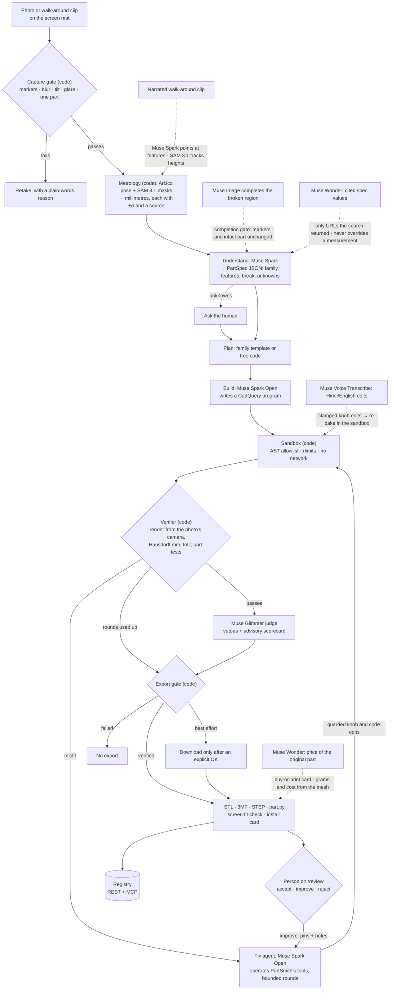

# PartSmith

**Photo of a broken part → a measured, verified, printable replacement — no caliper; your laptop screen is the ruler.**

<!-- BEGIN:links -->
Live site _(coming)_ · Video _(coming)_ · Judges page _(coming)_ · Try a sample _(coming)_ · [Results](#results) · [Reproduce](eval/REPRODUCE.md) · [Docs](docs/README.md)
<!-- END:links -->

[](docs/media/hero.gif)

<sub>Recorded from the web app replaying a stored live run (`make media`); the numbers are the stored run's own.</sub>

<!-- BEGIN:status -->
> **Status: live providers** · bench report 2026-11-02 at commit `2311505` plus uncommitted changes · real photos measured: 0 · real parts with ruler ground truth: 0 · real repairs logged: 0
>
> Numbers below come from live model calls on synthetic photos. Some stages ran as labelled mocks: see `provider_modes` in `eval/reports/latest/report.json`. Real-photo results are pending and say so in their tables.
<!-- END:status -->

<!-- BEGIN:headline -->
| Number | What it counts | Source |
|---|---|---|
| **17/17** | lying-model attacks blocked by code; suite: scripted attacks, no model calls | `eval/reports/latest/bypass.json` |
| **0/2** synthetic · **0/4** reference objects | verified parts that are > 0.5 mm off the ground truth (off / verified) | `eval/reports/latest/report.json` → `tables.*.headline.verified_but_off` |
| **6/6** control · **10/10** red-team | intact photos accepted · bad or unsuitable photos rejected or refused | `eval/reports/latest/report.json` → `tables.control`, `tables.redteam` |
| **0.1 mm** | median absolute error per dimension, synthetic photos, config PS, n = 12 | `eval/reports/latest/report.json` → `tables.synthetic.headline` |
<!-- END:headline -->

**The model proposes; code decides.** Entry for the Meta Global AI Developer Hackathon (Indie Developer track, problem
statement: Push the Frontier).

## Why it is different

- **No scanner, no caliper.** The web app draws a ring of ArUco markers at true 1:1 scale on your laptop or tablet screen
  (calibrated once against a bank card). You lay the part on it and take a phone photo or a short walk-around clip.
- **Numbers with error bars.** Every millimetre value carries an uncertainty and a source: measured from the photo,
  stated by you, cited from a spec, or inferred. The 3D view can colour the model by source.
- **Code decides.** Meta's models look, point, cut out and write CadQuery. Deterministic code measures, renders the model
  from the photo's own camera and compares. Only the verifier can mark a part verified, and every download goes through
  one export gate. A model that says "VERIFIED" on a wrong part is caught (see the first row of the table above).
- **Parametric, not a mesh.** Every part is a CadQuery program with named knobs (hole Ø, length, clearance). You change
  a knob, not the scale of a mesh, so the hole spacing stays right.
- **A person has the last word on what a photo cannot show.** Reviewers pin the photo, the fixer gets the notes, and code
  measures whether the next round fixed it.
- **An open registry.** Verified parts are searchable over REST and MCP, each with its verification record and knob schema.

## Try it in 2 minutes

`make setup && make dev`, then open <http://localhost:3000>. No keys needed: model stages run as labelled mocks, and the
stored runs replay as recorded (labelled "replay").

| # | Open | What you see |
|---|---|---|
| 1 | `/judges` | A stored live run replayed step by step, then *A lying model, caught*: a scripted model says "VERIFIED", the verifier's overlay shows the real error and the export is blocked |
| 2 | `/jobs` → **Battery compartment cover** (a recorded live run) | The job workspace: photo with the model drawn on it, 3D model, error per view, the fail → fix history, the agent's tool calls, knobs, buy-or-print card, cost from the job's own model calls |
| 3 | the job's *Check the fit on your screen* card → **See an example** | The 1:1 screen fit check: the model's outline drawn on the calibrated screen (`/jobs/{id}/fit?example=1` is a labelled example drawn from the job's own outline, never a measurement) |
| 4 | `/playground` | Every family template with presets: drag a knob, watch the CadQuery program change, download at your values |
| 5 | `/describe` | No part in hand: type what you need with your numbers; a template part is built and each of your numbers is measured on the model |
| 6 | `/review` → `/review/log` | The review desk (accept, send back with pins, reject; judge scorecard and vetoes beside the verifier's numbers) and the feedback log of what was fixed |
| 7 | `/admin` | Overview, registry moderation, taught rules, audit log and demand; every number names its source and its `n` |
| 8 | `/parts`, `/agents` | Registry search with match coverage, a part's `verification.json` and `params.json`, and the MCP / REST docs for coding agents |

In a terminal, `make lie` shows the same refusal in seconds: the scripted model's claim, the verifier's real max error
against the limit and `export BLOCKED (<reason>)` (`eval.bypass --demo` exits 3 when the export is refused, which is
the expected result; `make lie` reports it as OK). Which model ran each stage, live or mock: `/models`. Where the
numbers come from: [Results](#results), `/results` and [`eval/REPRODUCE.md`](eval/REPRODUCE.md).

[](docs/media/grid.png)

[](docs/media/pages.png)

## What is real and what is not yet

- The bench numbers come from live model calls on **synthetic photos** with exact ground truth, and on synthetic renders
  of standard reference objects. The status line above says so, and every table names its photo source. `make bench`
  re-scores the stored live runs without new model calls, so the report date in the status line is when the tables were
  last rebuilt, not when the models ran.
- The **real-part bench is pending**: no real photos have been measured yet, so the real-photo tables say "pending".
- The stored runs behind `/judges`, `/jobs` and the media are **replays** of live runs, labelled as replays. Reviews made
  by scripts are labelled tests and never count as a person's.
- No physical print results yet; the physical check is the screen fit check.

## The problem

A cupboard latch snaps, a battery cover goes missing, a cable clip cracks. The appliance still works, but the plastic piece
is not sold on its own, so the whole thing goes in the bin. A 3D print would fix it, but it has to be modelled to within half
a millimetre or it will not fit. That takes a caliper, CAD skills and an hour, which most people do not have.

PartSmith turns your laptop screen into a calibrated measuring mat. You lay the part on it and take a photo (or walk around
it with a short video). The result is a parametric part you can print, re-size with named knobs, or send to a print shop,
and it joins an open registry that people and coding agents can search over REST and MCP.

## Why trust a model-made part?

A language model can write a CAD file that looks right and is 2 mm off. For a replacement part, that is useless. PartSmith
never trusts what a model says about itself:

| A model proposes … | … and code decides | Where |
|---|---|---|
| SAM 3.1 returns a mask | ArUco pose, parallax correction and sub-pixel edge fitting turn it into mm with an uncertainty per value; the capture gate rejects blurred, tilted, glary or multi-part photos | `services/metrology` |
| Muse Spark names a feature and the pixel it is at | SAM 3.1 cuts that point out, code fits the circle or slot in mm | `services/metrology/points.py` |
| Muse Spark Open writes and edits CadQuery | It runs in a sandbox (AST allowlist, rlimits, no network); guards cap each edit and refuse uniform rescaling | `services/geom_worker`, `services/agent/guards.py` |
| The fix agent proposes a knob edit | Refused if it moves a knob out of a measured size test that already passes, unless a failing residual or a failing view's worst spot points at it; the rounds stop after two that make no progress | `services/agent/guards.py`, `services/agent/orchestrator.py` |
| The fix agent says "done" | The verifier re-renders from the photo's camera and re-measures model and photo with the same code; only it sets `verified` | `services/verifier` |
| Muse Wonder quotes a spec | Accepted only if a web search ran and the URL came back from it; cited values never override a measurement | `services/agent/providers/spec.py` |
| Muse Image completes the broken region | Accepted only if every mat marker re-detects in place and the intact part is unchanged | `services/metrology/recon_gate.py` |
| Muse Glimmer judges the result | Veto only: it can block a pass, never grant one; its vetoes are shown with the model and mode that made them | `services/agent/orchestrator.py` |
| Muse Spark points at features while you narrate a clip | A point is kept only if it lands on the part in its own frame and on the measured footprint; the words steer, never set a number | `services/metrology/narration.py` |
| Muse Spark reads a typed description | Template names, knob names and values are mapped and clamped by code; a "you said" value whose quote is not in your text is downgraded; the result is "Matches your numbers", never "verified" | `services/registry/describe.py` |
| A search finds the original part's price | Kept only with the source link the search returned and a quote that shows the price; grams, print time and cost come from the mesh | `services/agent/providers/buy.py`, `services/agent/buy_or_print.py` |
| A tall part is seen only from above | The photo bounds its length and width instead of fixing them; without a side view or clip, code refuses to verify an extruded guess, and every knob nothing checked is listed as inferred | `services/verifier/verify.py` |
| Anyone asks to download | Every download URL gives a best-effort part only after an explicit "I understand" and refuses a failed one | `services/verifier/ship.py`, `services/registry/gate.py` |

The table below shows these checks being attacked (all numbers are written by scripts):

<!-- BEGIN:evidence -->
| Check | Result | Source |
|---|---|---|
| Intact parts, normal photos → accepted | 6/6 handled as expected, 95 % CI [0.61, 1.00] | `eval/reports/latest/report.json` → `tables.control` |
| Photos that must be rejected or refused | 10/10 handled as expected, 95 % CI [0.72, 1.00] | `eval/reports/latest/report.json` → `tables.redteam` |
| Verified synthetic parts that are > 0.5 mm off the ground truth | 0/2 (config PS) | `eval/reports/latest/report.json` → `tables.synthetic` |
| Verified reference objects that are > 0.5 mm off the ground truth | 0/4 (config PS) | `eval/reports/latest/report.json` → `tables.reference_objects` |
| Edit a hole: scale the mesh vs change the program's knob (17 parts, 88 edits) | hole spacing moved 2.771 mm (median) with mesh scaling, 0.0 mm with the knob | `eval/reports/latest/program_vs_mesh.md` |
| A model that lies or cheats (says verified, edits the record, loosens limits, rescales to fit, fakes a break, smuggles imports, exports without consent) | 17/17 attempts blocked by code | `eval/reports/latest/bypass.json` |
| Real repairs logged | pending: no sessions logged yet (data/impact/sessions.yaml) | `data/impact/sessions.yaml` |
<!-- END:evidence -->

## Meta models, and where each one works

Every model call goes through [`services/agent/providers`](services/agent/providers) and is logged as a `model_call` event (provider,
model, tokens, ms, $). Agent stages also log their reasoning summaries, every tool call and where they are looking, and the
workspace shows them live. This table's file:line links are generated from the code by `tools/readme.py`.

<!-- BEGIN:meta-tooling -->
| Meta model | How we run it | Role | Where |
|---|---|---|---|
| **SAM 3.1** | Meta Model API | The measuring instrument: text-prompted part masks, point-prompted feature cuts (holes, slots, tapped points) and video tracking of a walk-around clip. Code turns every mask into millimetres | [`services/agent/providers/routing.py:110`](services/agent/providers/routing.py#L110) · [`services/metrology/segment.py:664`](services/metrology/segment.py#L664) · [`services/agent/evidence.py:166`](services/agent/evidence.py#L166) · [`services/agent/evidence.py:239`](services/agent/evidence.py#L239) |
| **Muse Spark 1.3** | Meta Model API | Understand stage: family, features, broken region, unknowns (strict PartSpec JSON), and the pixel it saw each hole or slot at, which SAM 3.1 then cuts and code measures. Watches and listens to a narrated walk-around clip and points at the features it hears about (frame and pixel), kept only if they land on the part. Turns a reviewer's notes into family rules the person ticks before they are kept, judges when Glimmer is not deployed, and turns a typed or spoken description with numbers into one template part whose numbers code then measures | [`services/agent/orchestrator.py:1233`](services/agent/orchestrator.py#L1233) · [`services/registry/describe.py:529`](services/registry/describe.py#L529) · [`services/review/rules.py:83`](services/review/rules.py#L83) · [`services/agent/evidence.py:57`](services/agent/evidence.py#L57) · [`services/agent/evidence.py:314`](services/agent/evidence.py#L314) |
| **Muse Spark Open** | open weights (Baseten / Fireworks / Together) | CadQuery builder, and the fix agent that operates PartSmith's own tools (inspect residuals, measure, segment, render, run tests, set knobs) until the verifier agrees | [`services/agent/orchestrator.py:1903`](services/agent/orchestrator.py#L1903) · [`services/agent/agent_loop.py:493`](services/agent/agent_loop.py#L493) |
| **Muse Glimmer 30B** | open weights (llama.cpp on a Modal GPU) | Independent judge: vetoes plus an advisory 1–5 scorecard (outline, features, printability, fit), shown the photos, the model's silhouettes, a shaded 3D view and crops zoomed on the verifier's worst spots. It can block, never pass | [`services/agent/orchestrator.py:2618`](services/agent/orchestrator.py#L2618) · [`infra/modal/glimmer.py:51`](infra/modal/glimmer.py#L51) |
| **Muse Wonder** | Meta Model API | Finds a published spec for the named appliance with web search. Code accepts a value only if a search really ran and its URL is one the search returned; cited values fill unknowns and never override a measurement. Also finds the original part's price with search grounding for the buy-or-print card (a price is kept only with its source link and a quote showing it) and plans part families for the factory | [`services/agent/evidence.py:398`](services/agent/evidence.py#L398) · [`services/agent/providers/buy.py:294`](services/agent/providers/buy.py#L294) · [`services/agent/providers/spec.py:140`](services/agent/providers/spec.py#L140) · [`services/registry/steer.py:545`](services/registry/steer.py#L545) |
| **Muse Image** | Meta Model API | Completes the broken region of the photo (accepted only if markers and the intact part are unchanged), an in-place repair preview and an install card (both labelled AI images) | [`services/agent/evidence.py:569`](services/agent/evidence.py#L569) · [`services/metrology/recon_gate.py:205`](services/metrology/recon_gate.py#L205) · [`services/media/preview.py:78`](services/media/preview.py#L78) |
| **Muse Voice Transcribe** | Meta Model API | Hindi/English voice edits ("make the hole a bit bigger") mapped to knob changes, live while you talk (realtime stream relayed by the API, knob names as keywords) or from a recorded clip, and spoken answers | [`services/media/voice.py:453`](services/media/voice.py#L453) · [`services/api/voice_live.py:139`](services/api/voice_live.py#L139) |
| **SAM 3 (open weights)** | open weights (Modal GPU) | All-open-weights segmentation path and bench | [`infra/modal/sam3.py:47`](infra/modal/sam3.py#L47) |
<!-- END:meta-tooling -->

With `OPEN_WEIGHTS_ONLY=1` every stage runs on open weights (Muse Spark Open, Muse Glimmer 30B, SAM 3 on a Modal GPU); stages
with no open-weights model (Muse Image, Muse Wonder spec search, Voice) fall back to a labelled deterministic mock, and the run
says so.

**Written but not claimed:** iterative Muse Image edits (`edit_image`) exist in the provider layer but are not wired into
the product yet, so they are not counted above.

## How it works



Solid arrows are the main pipeline; dotted arrows are side paths whose output code accepts only after a check. Boxes that
name a model are model calls; boxes marked "(code)" are deterministic, hand-written checks. The same diagram, with the
runtime layout (review, admin and spend-cap layers included), is in [`docs/ARCHITECTURE.md`](docs/ARCHITECTURE.md).

- **Screen mat.** The web app draws a ring of ArUco markers at true 1:1 scale on a laptop or tablet. You calibrate the scale once
  by matching an ID-1 bank card (85.60 × 53.98 mm). A plain-paper A4 mat PDF works too. Open the capture page on your phone with
  the QR code; the laptop follows the job live.
- **Measurement.** Sub-pixel marker corners → homography and camera pose → SAM 3.1 mask → contour in mm with exact parallax
  correction for the part's thickness, circle/slot fitting, see-through hole fitting for thick parts, and an uncertainty per
  value. A 5–10 s walk-around clip gives heights a single top photo cannot. Sizes the photo cannot see (a hidden depth) can
  be typed on `/fix`: they are labelled "stated by you", used by the builder and checked against the program, never verified.
- **Broken parts.** The broken region is masked out of the comparison: the part is verified on its intact region only, and the
  missing piece comes from the template, your stated size, a cited spec or a gated Muse Image completion, each labelled.
- **Agent loop.** The fix agent can inspect residuals, measure a feature, cut out a point, render a candidate, run the part
  tests and set knobs. Rendering is free; committing a change costs one of six rounds and passes the same guards. Code
  stops the loop early after two rounds that leave the shortfall where it was, and the job page says which rule kept the
  final round.
- **Verified** means: all P0 part tests pass, Hausdorff ≤ 0.5 mm on every view, IoU ≥ 0.97 on views large enough for IoU to
  mean something, and no veto from the independent judge. Only the verifier can set it. A best-effort part says which
  check failed.
- **Screen fit check.** Before printing, the model's 1:1 outline is drawn on the calibrated screen. You lay the real part on it
  and photograph it, and the same verifier says pass or fail with an overlay. A fit-test coupon (the hole at −0.2, 0 and
  +0.2 mm) learns your printer's clearance.
- **Spend cap.** `PARTSMITH_DAILY_USD_CAP` stops live model calls for the rest of the UTC day once that day's spend reaches
  the cap; the job fails with a clear message rather than falling back silently. `/status` and the admin overview show
  today's spend against the cap.

## Human review

Code decides whether a part matches the photo; only a person knows what the photo cannot show (the corner was square, this
hole takes an M3 screw). Every finished job waits on `/review` with the photo and the model side by side, the verifier's
numbers, the judge's scorecard and vetoes (with the model and mode that made them), each agent's calls and the cost.

- **Accept (A)** records a person's sign-off next to the verdict, never instead of it. An accepted part that the
  verifier did not pass publishes as "best effort, accepted by a person".
- **Improve (I)**: click the photo where something is wrong and say what. A reviewer round starts from that model (no new
  reading or plan): the fixer gets each note, a photo | model crop with the pin drawn as a numbered ring, and the
  local mismatch code measures at the pin. It comes back as the next round with each pin's mismatch before → after.
- **Reject (R)** with a reason, kept as a lesson candidate.
- **Paste a screenshot** (Ctrl+V) or drop a picture of how the part should look; it goes to the fixer with the notes.
- **Feedback log** (`/review/log`): every send-back and rejection, grouped by part, with what was wrong, *why it matters*
  (the reviewer's reason), a close-up of the pinned spot and what code measured in the next round (fixed, better, not
  fixed). A person's feedback measured as fixed, with its reason, is given to later jobs of the same family; each entry
  shows how later reviews of those jobs went, so a lesson that does not hold is visible.
- **Memory.** On accept, Muse Spark drafts one general rule per note for the part's family; the reviewer edits and ticks
  them. Only ticked rules reach future builder and fixer prompts for that family, each with the job it came from, and
  `/lessons` shows how later reviews of jobs that used a rule went. An admin can switch a taught rule off on `/admin`.
- **Who reviewed.** Every decision says whether a person made it or it was a scripted test; tests never promote a rule,
  publish a part or count toward agreement. The recorded hinge-leaf chain on `/review` is a labelled test chain.
- **Judge vs person.** The judge's 1–5 scorecard is advice; it sees the photos, the model's silhouettes and a shaded 3D
  view, because a silhouette cannot show a rolled barrel or a countersink. `/review` counts how often it agreed with the
  reviewer (Cohen's κ from the stored reviews, with the number of reviewers).

## Admin console

`/admin` (admin token when `PARTSMITH_ADMIN_TOKEN` is set; open in development mode, and the page warns about it):

- **Overview**: jobs made here and recorded, pass rate, rounds to verify, max-error median and P90, why people sent parts
  back, review states, registry and request counts, cost by stage and model, and today's spend against the cap. Every
  block is computed by `services/admin` from stored data and carries its `n` and a source.
- **Registry**: unpublish or republish a part with a reason; each part lists the criteria it meets.
- **Taught rules**: every rule and fixed feedback that later jobs are given, the jobs that used it, and an off switch.
- **Audit**: an append-only log of every admin write and review decision.
- **Demand**: open part requests and searches that found nothing close (no IP or user agent is logged).

## Registry and agents

- **Search** (`/parts`, MCP `search_parts`) returns a `coverage` score and a `match` of good, partial or none with a hint,
  so an agent can tell "nothing close" from a weak match. Searches that find nothing close are listed by `GET /demand`.
- **Per-part records**: `/api/v1/parts/{slug}/verification.json` (the stored verification record) and `params.json` (the
  knobs as a JSON-Schema document); both are on the part page's Data tab.
- **Playground**: `/api/v1/templates` lists the family templates; `/templates/{name}/bake` builds one at any knob values;
  its downloads go through the template export gate.
- **REST**: `/api/v1` ([docs/API.md](docs/API.md), OpenAPI at `/api/v1/openapi.json`).
- **MCP**: `uv run python -m services.mcp --stdio`, or streamable HTTP at `/mcp`. Tools: `search_parts`, `get_part`,
  `get_variant`, `bake`, `verify`, `get_lessons`, `find_matching`, `list_families`, `measure_photo`, `get_job`,
  `start_fix_job`, `report_need` ([services/mcp/README.md](services/mcp/README.md)).
- **Agent rules**: never rescale a part to force a fit — change the right knob; if no part matches, say so and call
  `report_need`; report which dimensions were measured and which were assumed.

## Model-written vs hand-written

At run time the models write **data**: specs, programs, points, tool calls, citations and images. They never write or run
the code that judges that data. Everything a model produces lands in the job's run directory
(`$PARTSMITH_HOME/runs/<job>/`) as a labelled file or event, next to the code's verdict.

| Written by a model at run time | Model | Where it lands |
|---|---|---|
| PartSpec JSON: family, features, broken region, unknowns (code then fills in measured values and their sources) | Muse Spark | `partspec.json` |
| Feature points: the pixel each hole or slot is at, and the frame and pixel tied to words in a narrated clip | Muse Spark | `run.jsonl` (`focus` events), then SAM 3.1 cuts and code measures |
| CadQuery programs (`PARAMS` + `build(p)`) and each fix round's edits | Muse Spark Open | `part.py`, `run.jsonl` |
| The fix agent's tool calls (inspect residuals, measure, segment, render, run tests, set knobs) and reasoning summaries | Muse Spark Open | `run.jsonl` (`tool_call`, `thought` events) |
| Masks of the part and of tapped points; video tracks | SAM 3.1 | `run.jsonl` artifacts |
| Cited spec values and prices, with the search URLs | Muse Wonder | `run.jsonl`, the buy-or-print card |
| Completion of the broken region, repair preview, install card (labelled AI images) | Muse Image | `run.jsonl` artifacts |
| Veto notes and the advisory scorecard | Muse Glimmer | `verification.json` → `vetoes`, `judge.json` |
| Draft family rules from a reviewer's notes | Muse Spark | the review record, kept only when a person ticks them |
| A described part's template and values, with sources | Muse Spark | `$PARTSMITH_HOME/describe/<id>.json` |
| Transcripts of voice edits | Muse Voice Transcribe | `run.jsonl` |

| Hand-written, deterministic code | Where |
|---|---|
| Metrology: mats, pose, capture gate, mask → mm, circle and slot fits, uncertainty per value | [`services/metrology`](services/metrology) |
| Verifier: render from the photo's camera, metrics, part tests, the pass rule; the only writer of `verified` and `verification.json` | [`services/verifier`](services/verifier) |
| Guards on model output: edit caps, no uniform rescale, pinned knobs, knob ranges; acceptance checks for points, citations and completions | [`services/agent/guards.py`](services/agent/guards.py) · [`services/agent/evidence.py`](services/agent/evidence.py) · [`services/agent/providers/spec.py`](services/agent/providers/spec.py) · [`services/metrology/recon_gate.py`](services/metrology/recon_gate.py) |
| Sandbox for model-written CadQuery | [`services/geom_worker`](services/geom_worker) |
| Export gate | [`services/verifier/ship.py`](services/verifier/ship.py) · [`services/registry/gate.py`](services/registry/gate.py) |
| Orchestrator, jobs, family templates, prompts, daily spend cap, the labelled mock brain used with no keys | [`services/agent`](services/agent) |
| Review store, pins, feedback ledger; admin overview, moderation and audit log | [`services/review`](services/review) · [`services/admin`](services/admin) |
| Registry, REST API, MCP server | [`services/registry`](services/registry) · [`services/api`](services/api) · [`services/mcp`](services/mcp) |
| Web app | [`apps/web`](apps/web) |
| Benches, scorers, lying-model suite, synthetic photo generator | [`eval`](eval) · [`tools/synth`](tools/synth) |

## Results

Every number here is written by `make bench` (`tools/readme.py` reads `eval/reports/latest/`). Ground-truth sources are never
mixed: synthetic photos (exact), standard reference objects (published specs), real broken parts (school ruler, ±0.5 mm).

<!-- BEGIN:bench -->
Generated 2026-11-02T20:53:37+00:00 at commit `231150543799ec889330553ab61172228bbe191e` · mode **live**.

**Synthetic bench (exact ground truth)**

N = 12 · photos: synthetic renders · ground truth: `synthetic_exact` · CI: 95 %: bootstrap over samples (2000 resamples, seeded) for mean errors; Wilson for rates

| config | n | median_abs_err_mm | mean_abs_err_mm | mean_ci95 | pass@0.5 | verified_rate | verified_but_off | median_iters | usd_per_job |
|---|---|---|---|---|---|---|---|---|---|
| B1 | 12 | 0.18 | 0.856 | [0.313, 1.674] | 0.083 | 0.083 | 0/1 | 1 | $0.0681 |
| PS | 12 | 0.1 | 0.604 | [0.221, 1.196] | 0.25 | 0.167 | 0/2 | 6 | $0.2091 |
| PS-noTemplate | 12 | 0.23 | 0.914 | [0.481, 1.574] | 0.083 | 0.167 | 1/2 | 4.5 | $0.2130 |

_headline = PS on the held-out split (12 samples)_

**Reference objects (vs published specs)**

N = 8 · photos: synthetic renders · ground truth: `reference_spec` · CI: 95 %: bootstrap over samples (2000 resamples, seeded) for mean errors; Wilson for rates

| config | n | median_abs_err_mm | mean_abs_err_mm | mean_ci95 | pass@0.5 | verified_rate | verified_but_off | median_iters | usd_per_job |
|---|---|---|---|---|---|---|---|---|---|
| B1 | 8 | 0.04 | 0.142 | [0.027, 0.330] | 0.75 | 0.25 | 0/2 | 1 | $0.0492 |
| PS | 8 | 0.05 | 0.155 | [0.052, 0.303] | 0.75 | 0.5 | 0/4 | 2.5 | $0.1631 |
| PS-noTemplate | 8 | 0.066 | 0.159 | [0.049, 0.336] | 0.75 | 0.5 | 0/4 | 2.5 | $0.2073 |

_headline = PS on the held-out split (8 samples)_

**Real broken parts (vs school ruler, ±0.5 mm)**

_Pending — no real parts with ruler ground truth yet (data/real/<part>/gt.yaml, see eval/REPRODUCE.md)._

**Measurement only (photo → mm, no CAD loop)**

```
synthetic                        photos 120 accepted  97  dims N=228  mean 0.468 [0.370, 0.580]  median 0.200  P90 1.039  max 5.316  ≤0.5 77 %
  top view, flat parts                   dims N= 82  mean 0.226 [0.181, 0.273]  median 0.165  P90 0.544
  top view, parts with tall features     dims N= 98  mean 0.494 [0.324, 0.690]  median 0.129  P90 1.378
  expected rejections (white part on light stage): 5/6 correctly rejected
reference_objects_synthetic      photos  30 accepted  21  dims N= 35  mean 0.178 [0.114, 0.264]  median 0.087  P90 0.307  max 1.312  ≤0.5 91 %
reference_objects_real           pending (no photos)
real_parts_ruler                 pending (no photos)
EXIT GATE (mean ≤ 0.4 mm): synthetic 0.468 FAIL · reference objects [reference_objects_synthetic] 0.178 PASS → FAIL
```
<!-- END:bench -->

## Run it

```bash
make setup        # uv sync (Python 3.12) + pnpm install + generated types
make dev          # seeds the registry from the bundled samples, starts API :8000 and web :3000
make test         # unit tests, no network, no keys
make bench        # rebuilds every results table from stored runs (no keys needed)
make lie          # a scripted model claims VERIFIED on a wrong part; code refuses the export
make smoke        # one call per provider: ✅ live · ⚠️ key missing (mock) · ❌ failed
make live         # smoke, then re-run the benches on live models
```

With no keys every model stage runs as a deterministic mock, and the app says so on every page. Add keys to `.env` (see
`.env.example`) and run `make live`; set `PARTSMITH_DAILY_USD_CAP` to cap a day's live spend. Self-hosting Glimmer and
SAM 3 on Modal: [`infra/modal/README.md`](infra/modal/README.md).

## Pages

| Page | What it is for |
|---|---|
| `/fix` | Upload photos or a clip (or scan the QR on your phone), narrate the clip, tap holes or the broken edge, type sizes the photo cannot see, describe the part in English or Hinglish |
| `/calibrate`, `/mat` | Match a bank card once; the full-screen 1:1 measuring mat |
| `/jobs`, `/jobs/{id}` | Recent jobs (attempts at the same part folded together); the live workspace: photos, 3D model, error per view, the agent's thoughts and tool calls, knobs, live Hindi/English voice edits, buy-or-print, cost, exports with "open in slicer", and a fit-test coupon that learns your printer's clearance |
| `/jobs/{id}/fit` | 1:1 screen fit check (`?example=1`: a labelled example from the job's own outline) |
| `/describe` | No part in hand: type or say what it is with your numbers; a template part is built and every number you gave is measured on the model ("Matches your numbers", never "verified") |
| `/playground` | Every family template as an example with presets: drag knobs, watch the CadQuery program change, share the link, download at your values |
| `/parts`, `/parts/{slug}` | The registry: search with match coverage; parametric parts with knobs, fit presets per printer and material, verification record and knob schema, share cards |
| `/p/{id}` | Repair passport: reprint a part from its verified model with your printer's learned clearance |
| `/requests` | Parts people need that nobody has made yet; vote on them |
| `/factory` | Muse Wonder plans part families; a human approves before anything is published |
| `/review`, `/review/log` | Review desk: accept, send back with pins on the photo, or reject; judge-vs-person agreement; the feedback log |
| `/lessons` | What the agent learned from failures and reviews, promoted only with evidence or a person's tick |
| `/admin` | Admin console: overview with sources, registry moderation, taught rules, audit log, demand |
| `/shop` | Batch jobs for a print shop, with a job-sheet PDF |
| `/results`, `/models`, `/judges`, `/how` | Benchmarks, per-stage model routing, stored replays and a lying model being caught, the five steps in plain words |
| `/agents` | REST, MCP and `llms.txt` for coding agents |

## Limitations (honest)

- The status line at the top says whether the current numbers come from mock or live providers. With mock providers they
  check the pipeline, verifier and scorer; they do not measure any model. Every table repeats the label.
- A single top photo cannot resolve heights above the stated plate thickness; the walk-around clip and side photo handle it,
  but raw top-view measurements of tall features are biased (see the measurement-only table).
- White or light-grey parts need the dark screen stage; the capture gate asks for it.
- Flexible parts (rubber seals, gaskets) and free-form objects (figurines, sculptures) are refused with a reason: a rigid
  parametric model cannot replace them.
- Real reference-object photos and real broken parts are pending; those tables say "pending" until they exist.
- Judge-vs-person agreement needs reviews by people; scripted test reviews are excluded, so its `n` is small until then.
- No physical print results yet; the physical proof is the screen fit check. Prints are optional and will only be reported if
  made.

## Repository map

| Path | What |
|---|---|
| `services/metrology` | mats, card scale, capture gate, pose, segmentation, point cuts, walk-around clips, mm features, fit check |
| `services/geom_worker` | sandboxed CadQuery execution, exporters, bake cache |
| `services/verifier` | camera-frame comparison, metrics, part tests, the pass rule, the export gate |
| `services/agent` | orchestrator, fix agent and its tools, guards, providers and the spend cap, templates, prompts, jobs and replays |
| `services/review`, `services/admin` | review store, pins and feedback ledger; admin overview, moderation, taught rules, audit log |
| `services/api`, `services/mcp`, `services/registry` | REST + SSE, MCP, registry, describe, factory |
| `apps/web` | Next.js app |
| `tools/synth`, `eval` | synthetic photo generator with exact ground truth, benches, suites and reports |
| `tools/readme.py` | writes every generated block of this README |
| `docs/` | architecture, API, decisions, progress: see the [docs index](docs/README.md) |

## Built during the hackathon

All code in this repository was written during the hackathon (from Oct 26 2026, 12:00 PM ET). This table and the commit list
are computed from `git log`, so they stay true as the history grows.

<!-- BEGIN:built -->
**56 commits** between 2026-10-27 05:59 ET and 2026-10-31 19:08 ET; the hackathon started 2026-10-26 12:00 ET. Commits dated before the start: **0**.

| Area | Files added | Lines added: code and docs | Lines added: data, reports, lockfiles, generated | First commit | Last commit |
|---|---|---|---|---|---|
| `services/` (Python backend) | 302 | 60,915 | 0 | 2026-10-27 | 2026-10-31 |
| `apps/web/` (web app) | 354 | 43,287 | 5,520 | 2026-10-27 | 2026-10-31 |
| `eval/` (benches and reports) | 570 | 5,415 | 82,875 | 2026-10-27 | 2026-10-31 |
| `packages/` (typed contracts) | 12 | 1,434 | 5,657 | 2026-10-27 | 2026-10-31 |
| `tools/` (synthetic data, mats, generators) | 32 | 5,177 | 0 | 2026-10-27 | 2026-10-31 |
| `infra/` (Modal, deploy) | 12 | 1,014 | 88 | 2026-10-27 | 2026-10-31 |
| `docs/` | 18 | 2,276 | 7 | 2026-10-27 | 2026-10-31 |
| `data/` (samples, replays) | 4,293 | 0 | 656,539 | 2026-10-27 | 2026-10-30 |
| root files | 16 | 1,384 | 8,277 | 2026-10-27 | 2026-10-31 |
| **Total** | **5,609** | **120,902** | **758,963** | | |

<details><summary>Every commit since the start, oldest first</summary>

| Date | Commit | Subject |
|---|---|---|
| 2026-10-27 05:59 ET | `ec85b78` | chore: scaffold monorepo, typed contracts, job state machine and registry store |
| 2026-10-27 06:27 ET | `c2d834e` | feat(providers): zero-key provider layer, media clients, Modal infra and smoke test |
| 2026-10-27 06:36 ET | `1ebe4ff` | feat(metrology): screen/paper mats, card scale, capture gate, parallax-corrected measurement, screen fit check |
| 2026-10-27 06:41 ET | `07f8bcc` | feat(geometry): sandboxed CadQuery worker, deterministic verifier and 10 family templates |
| 2026-10-27 06:44 ET | `7391a0d` | feat(web): Next.js app with design system, screen mat, card calibration, job workspace and registry pages |
| 2026-10-27 07:17 ET | `2a07432` | feat(agent): bounded fix loop with code-decided verification, deterministic mock brain, service facade and CLI |
| 2026-10-27 07:18 ET | `4a173f6` | feat(synth,eval): synthetic photo generator with exact ground truth, reference objects and measure-only bench |
| 2026-10-27 07:19 ET | `88b0991` | feat(api,mcp,registry): REST API with SSE, MCP server, registry operations, Steer factory, seeding and thumbnails |
| 2026-10-27 07:28 ET | `3237b2f` | feat(verifier): camera-frame comparison, like-for-like part tests and per-view gates |
| 2026-10-27 07:57 ET | `6f7f5fb` | feat(eval): full-loop bench with baselines, ablations, reports and regression check |
| 2026-10-27 08:01 ET | `527018d` | feat(metrology): see-through hole fitting, shadow suppression, dark stage contrast gate, thin side views, round profiles |
| 2026-10-27 08:03 ET | `0827de1` | docs(readme): judge-facing README with script-generated Meta tooling table and bench tables |
| 2026-10-27 08:24 ET | `0da1e26` | feat(synth,eval): dark screen stage, white-on-light rejection cases, round profiles and flat/tall split in the measure bench |
| 2026-10-27 08:28 ET | `ddd4526` | feat(web): integrate with the live API, SSE pass-through, dark stage, live Playwright suite |
| 2026-10-27 08:34 ET | `a705786` | fix(api): integration bugs found by the live web suite |
| 2026-10-27 08:50 ET | `c605235` | feat(metrology): robust dark-stage segmentation, stricter shadow model, honest side-view ranges |
| 2026-10-27 08:51 ET | `36eda42` | feat(agent): camera-frame verification in the loop, retake handling, stronger deterministic fixer |
| 2026-10-27 08:59 ET | `e3238b5` | feat(registry): dedupe publishing by program identity; repo-wide strict typing |
| 2026-10-27 09:10 ET | `0b37762` | fix(verifier): model re-measured with metrology's own footprint code; round views verified in the photo frame |
| 2026-10-27 09:30 ET | `cb9d823` | fix(verifier): compare sub-pixel edges, not the binary mask's blur halo; scale-aware IoU gate |
| 2026-10-27 09:38 ET | `7cbb37c` | feat(web): polish pass — part-cropped photo panel, server-rendered registry, lazy 3D, keyboard and screen-reader paths |
| 2026-10-27 09:49 ET | `1d815f4` | feat(agent): region-aware fixing, new template knobs and boss detection for free code |
| 2026-10-27 10:04 ET | `0910de1` | feat(eval,replays): fresh mock bench, seeded registry replays for the judge path |
| 2026-10-27 10:05 ET | `426c1bf` | feat(eval): real-part split freezing and photo-source labels on every results table |
| 2026-10-27 10:14 ET | `c591933` | perf(web): mobile Lighthouse 95+ — zod/mini contract checks, lean UI primitives, server-rendered sections, subset fonts |
| 2026-10-27 10:18 ET | `1da606f` | docs: quality scorecard, handoff, progress log and FAQ for the zero-key build |
| 2026-10-27 10:26 ET | `5c301cc` | feat(templates): hinge knuckle placement and hook hole-row knobs; pattern knobs probed first |
| 2026-10-27 10:46 ET | `732ee27` | feat(schemas): round-2 contracts — cited values with citations, thought/tool_call/focus events, orbit view, new artifact kinds |
| 2026-10-27 13:47 ET | `11c3ed1` | feat(metrology): SAM point-prompt feature fits, walk-around orbit measurement, Muse Image reconstruction gate |
| 2026-10-27 13:47 ET | `25042a8` | feat(providers): Spark/Wonder tool-calling loop, SAM 3.1 point and video prompts, cited spec lookup, Muse Image edits, realtime voice |
| 2026-10-27 13:53 ET | `66078af` | feat(verifier): functional probe tests, single export gate with a lying-brain suite, measured program-vs-mesh |
| 2026-10-27 14:03 ET | `fc0cf16` | feat(api,registry): product catalogue, export gate on every download, bundles, presets, requests, lessons, batches, usage |
| 2026-10-27 14:26 ET | `ef58595` | feat(agent): Spark drives the instrument — agentic fixer over our metrology and verifier tools, plus points, orbit, cited specs and gated completions |
| 2026-10-27 14:44 ET | `51174b5` | feat(synth,eval): walk-around clips, broken parts, control and red-team suites, failure taxonomy, provenance, impact and open-weights reports |
| 2026-10-27 15:00 ET | `cc3fed8` | feat(verifier): walk-around frames verify heights; broken parts verified on the intact region only |
| 2026-10-27 15:14 ET | `061ce7c` | feat(agent,api): refuse flexible and organic objects; fix uploads accept a walk-around clip and tapped feature points |
| 2026-10-27 15:22 ET | `4d7ab79` | fix(metrology): robust walk-around height, plausibility checks on Muse Image completions, single-part capture check |
| 2026-10-27 18:34 ET | `b3da84b` | feat: round-2 web, gated exports everywhere, two-part rejection, fresh evidence and judge-first README |
| 2026-10-27 20:21 ET | `1c91d0f` | feat(verifier,agent): broken parts locate the break and never copy it; fake-break attack; verified-but-off column |
| 2026-10-28 12:13 ET | `a1cc532` | feat: round 3 — bounded top views, buy-or-print, narrated walk-around, live voice, coupon learning, lie caught, deploy files |
| 2026-10-28 13:53 ET | `d7586ff` | feat: stated lengths, SAM negatives and confidence, value sources in 3D, fail-to-fix strip, judge-first README |
| 2026-10-28 14:36 ET | `7055646` | feat(web): README hero media from the real app; fix /fix clip crash and a stuck 3D camera |
| 2026-10-29 07:23 ET | `95790e6` | feat: first live runs, fits-where-it-goes, repair passport, live fixes |
| 2026-10-29 14:08 ET | `304f933` | feat: live lessons round 2, slow-route fallback, second live seed |
| 2026-10-29 16:46 ET | `277f8fc` | feat: first live bench, spend cap, through-holes a model mask closed |
| 2026-10-29 17:03 ET | `77d821a` | feat(web): README media from a live run, distinct replay chips; latch corner live rerun |
| 2026-10-29 17:41 ET | `1cce252` | feat: draft demo video target, strict-JSON bench reports, results and replay fixes |
| 2026-10-30 03:28 ET | `57ece97` | feat: human review loop with reviewer rounds, judge scorecard and family rules |
| 2026-10-30 10:27 ET | `d4025df` | feat: judge sees a shaded 3D view, labelled test reviews, recorded review chain |
| 2026-10-30 11:58 ET | `6d608b5` | feat: review desk, feedback log with reasons, pasted screenshots, plainer site |
| 2026-10-31 05:46 ET | `12d4626` | feat: admin console, landing drawing set, describe and playground, search coverage, spend cap |
| 2026-10-31 07:01 ET | `77aeeda` | fix: honest numbers and wording, search that finds its examples, weakest pages reworked |
| 2026-10-31 16:56 ET | `a5ed156` | fix: job pages name the real failure, plainer pages, one explained pass rate |
| 2026-10-31 18:00 ET | `e7f0eaa` | fix: judge vetoes shown, one registry count, pages that agree with each other |
| 2026-10-31 18:22 ET | `de343ab` | fix: no claim that a person reviewed the scripted hinge chain; honest learning row and hero caption |
| 2026-10-31 19:08 ET | `2311505` | feat: fix-loop guardrails, one count vocabulary, visible fit check, grouped attempts |

</details>

_Generated from `git log --numstat --summary` by `tools/readme.py` (author dates, Eastern Time). Lines added are summed over commits, so a file rewritten twice counts twice. A commit made after the last regeneration appears at the next `make bench`._
<!-- END:built -->

## Credits

<!-- Prashant writes this section. -->

## License

MIT for the code. Registry parts: CC BY 4.0.
