# PartSmith

**Photo of a broken part → a measured, verified, printable replacement. No caliper: your laptop screen is the ruler.**

<!-- BEGIN:badges -->
[](https://github.com/Prashant-thakur77/partsmith/actions/workflows/ci.yml)   [](docs/PROOF.md) [](docs/PROOF.md) [](eval/reports/latest/open_weights.json) [](eval/reports/latest/bypass.json)
<!-- END:badges -->

<!-- BEGIN:links -->
**[Live site](https://partsmith-52-204-199-249.sslip.io)** · **[Video](https://youtu.be/bdMTeAaa7dY)** · **[Judges page](https://partsmith-52-204-199-249.sslip.io/judges)** · **[Try a sample](https://partsmith-52-204-199-249.sslip.io/jobs/demo)** · [Results](#results) · [Reproduce](eval/REPRODUCE.md) · [Docs](docs/README.md)
<!-- END:links -->

<!-- BEGIN:film -->
**[Watch the demo film](https://youtu.be/bdMTeAaa7dY)**
<!-- END:film -->

[](docs/media/hero.gif)

<sub>Recorded from the web app replaying a stored live run (`make media`); the numbers are the stored run's own.</sub>

<!-- BEGIN:status -->
> **Status: live providers** · bench report 2026-11-04 at commit `1f77aad` plus uncommitted changes · real photos measured: 0 · real parts with ruler ground truth: 0 · real repairs logged: 0
>
> Numbers below come from live model calls on synthetic photos. Some stages ran as labelled mocks: see `provider_modes` in `eval/reports/latest/report.json`. Real-photo results are pending and say so in their tables. Public photos pasted on a rendered mat have their own table and are not counted as real photos.
<!-- END:status -->

<!-- BEGIN:headline -->
| Number | What it counts | Source |
|---|---|---|
| **17/17** | lying-model attacks blocked by code; suite: scripted attacks, no model calls | `eval/reports/latest/bypass.json` |
| **0/2** synthetic · **0/4** reference objects · **4/4** intact parts, top photo only · **2/6** public photos | verified parts that are > 0.5 mm off the ground truth on some dimension (off / verified); [every one is listed](#every-verified-part-against-ground-truth) | `eval/reports/latest/report.json` → `tables.*.headline.verified_but_off`, `runs.*.PS` |
| **6/6** control · **10/10** red-team | intact photos accepted · bad or unsuitable photos rejected or refused | `eval/reports/latest/report.json` → `tables.control`, `tables.redteam` |
| **0.1 mm** | median absolute error per dimension, synthetic photos, config PS, n = 12 | `eval/reports/latest/report.json` → `tables.synthetic.headline` |
<!-- END:headline -->

**The model proposes; code decides.** Entry for the Meta Global AI Developer Hackathon (Indie Developer track, problem
statement: Push the Frontier).

**Contents:** [The problem](#the-problem-and-who-it-serves) · [What people use today](#what-people-use-today) · [Try it](#try-it-in-2-minutes) ·
[Time and why it works](#how-long-it-takes-and-why-it-works) ·
[What Meta made possible](#what-was-not-possible-before-and-how-metas-models-made-it-possible) ·
[How it works](#how-it-works) · [Why trust it](#why-trust-a-model-made-part) · [Results](#results) ·
[Verify it yourself](#verify-it-yourself) · [Judging criteria](#judging-criteria-and-where-to-check-each-one) ·
[Limitations](#limitations) · [Decisions](#key-decisions) · [Human review](#human-review) ·
[Registry, API and MCP](#registry-api-and-mcp) · [Run and deploy](#run-self-host-deploy) ·
[Repository map](#repository-map) · [Built during the hackathon](#built-during-the-hackathon)

## The problem and who it serves

It is nine at night and someone's father reaches for the TV remote. It has been held together with a rubber band for
years, because one small plastic battery cover snapped. The remote still works. Nobody makes that cover now, and the shop
says to buy a new remote. A print shop could make one tonight, but it needs an exact file, and half a millimetre off means
it will not click shut.

The same thing happens with a cupboard latch, a cable clip, a mixer knob or a cooler wheel: a small plastic piece fails, it
is not sold on its own, and the whole thing goes in the bin. A 3D print would fix it, but modelling it takes a caliper and
CAD skills that most people do not have.

PartSmith turns a laptop screen into a calibrated measuring mat. You lay the part on it and take a photo, or walk around it
with a short video. The result is a parametric part you can print, re-size with named knobs or send to a print shop, and it
joins an open registry that people and coding agents can search.

| Who | What they have | What they get |
|---|---|---|
| A household with a broken part | A phone and a laptop; no CAD, no caliper, no printer | A checked file for a print shop, plus a 1:1 outline to test the real part against on screen |
| A repair or print shop | Customers with a part nobody stocks | Batch jobs with a job sheet (`/shop`), and files with the checks attached |
| People who own a 3D printer | A printer, but no way to design the part they need | Parametric parts, fit presets, a coupon that learns their printer's clearance |
| Coding agents | A task that needs a physical part | Search, knobs and bakes over REST and MCP, each part with its verification record |

**Why now.** Entry-level 3D printers now ship at a rate of [over a million a quarter (CONTEXT, Q1 2025)](https://www.tctmagazine.com/additive-manufacturing-3d-printing-news/tariffs-fears-push-entry-level-3d-printer-shipments-in-q1-to-1-million/),
and the [EU's 2024 repair directive](https://cm.twobirds.com/en/insights/2024/germany/recht-auf-reparatur-richtlinie-veroeffentlicht-auswirkungen-fuer-wirtschaftsakteure-in-der-eu)
stops makers blocking 3D-printed spare parts. Electronics thrown out reached
[62 billion kg in 2022 (Global E-waste Monitor 2024, UN)](https://www.unitar.org/about/news-stories/press/global-e-waste-monitor-2024-electronic-waste-rising-five-times-faster-documented-e-waste-recycling).

**The aim.** One snapped piece of plastic should not mean throwing out the whole thing. The aim is an open library of
verified parts, so the next person with that remote downloads the part instead of measuring it again.

## Why it is different

- **No scanner, no caliper.** The web app draws a ring of ArUco markers at true 1:1 scale on your laptop or tablet screen
  (calibrated once against a bank card). You lay the part on it and take a phone photo or a short walk-around clip.
- **Numbers with error bars.** Every millimetre value carries an uncertainty and a source: measured from the photo,
  stated by you, cited from a spec, or inferred. The 3D view can colour the model by source.
- **Code decides.** Meta's models look, point, cut out and write CadQuery. Deterministic code measures, renders the model
  from the photo's own camera and compares. Only the verifier can mark a part verified, and every download goes through
  one export gate. A model that says "VERIFIED" on a wrong part is caught (see the first row of the table above).
- **Parametric, not a mesh.** Every part is a CadQuery program with named knobs (hole Ø, length, clearance). You change
  a knob, not the scale of a mesh, so the hole spacing stays right.
- **A person has the last word on what a photo cannot show.** Reviewers pin the photo, the fixer gets the notes, and code
  measures whether the next round fixed it.
- **An open registry.** Verified parts are searchable over REST and MCP, each with its verification record and knob schema.

## What people use today

| | From one phone photo | True millimetres | Editable program | Checked against your part before printing |
|---|---|---|---|---|
| AI image-to-3D | Yes | Guessed | Mesh | No |
| Phone scan apps | Many photos | Rough | Mesh | No |
| Text-to-CAD | You type it | If you know them | Yes | No |
| Part libraries | Search only | Varies | Varies | No |
| CAD by hand | Caliper | Yes | Yes | Print to find out |
| **PartSmith** | Yes | Measured | Yes | Yes, by code |

We found none that check the result against your part, in millimetres, before you print. That is the difference: PartSmith
measures from a known scale, writes a program rather than a mesh, and a verifier compares the result with the photos before
any filament is used. Tools in the other rows do things it does not. Image-to-3D handles free-form shapes it refuses, and CAD
by hand can model anything its author can measure. For a sense of the first row, see
[All3DP's test of AI generators](https://all3dp.com/2/ai-generated-3d-model-best-tools/). The table is our reading of each
category, not a measured comparison.

**The limit on the PartSmith row:** real phone captures are not yet tested. The measurements so far come from rendered photos
and from public photos pasted on a rendered mat ([Limitations](#limitations)).

## Try it in 2 minutes

`make setup && make dev`, then open <http://localhost:3000>. No keys needed: model stages run as labelled mocks, and the
stored runs replay as recorded (labelled "replay").

| # | Open | What you see |
|---|---|---|
| 1 | `/judges` | A stored live run replayed step by step, then *A lying model, caught*: a scripted model says "VERIFIED", the verifier's overlay shows the real error and the export is blocked |
| 2 | `/jobs` → **Battery compartment cover** (a recorded live run) | The job workspace: photo with the model drawn on it, 3D model, error per view, the fail → fix history, the agent's tool calls, knobs, buy-or-print card, cost from the job's own model calls |
| 3 | the job's *Check the fit on your screen* card → **See an example** | The 1:1 screen fit check: the model's outline drawn on the calibrated screen (`/jobs/{id}/fit?example=1` is a labelled example drawn from the job's own outline, never a measurement) |
| 4 | `/playground` | Every family template with presets: drag a knob, watch the CadQuery program change, download at your values |
| 5 | `/describe` | No part in hand: type what you need with your numbers; a template part is built and each of your numbers is measured on the model |
| 6 | `/review` → `/review/log` | The review desk (accept, send back with pins, reject; judge scorecard and vetoes beside the verifier's numbers) and the feedback log of what was fixed |
| 7 | `/admin` | Overview, registry moderation, taught rules, audit log and demand; every number names its source and its `n` |
| 8 | `/parts`, `/agents` | Registry search with match coverage, a part's `verification.json` and `params.json`, and the MCP / REST docs for coding agents |

In a terminal, `make lie` shows the same refusal in seconds: the scripted model's claim, the verifier's real max error
against the limit and `export BLOCKED (<reason>)` (`eval.bypass --demo` exits 3 when the export is refused, which is
the expected result; `make lie` reports it as OK). Which model ran each stage, live or mock: `/models`. Where the
numbers come from: [Results](#results), `/results` and [`eval/REPRODUCE.md`](eval/REPRODUCE.md).

[](docs/media/grid.png)

[](docs/media/pages.png)

## How long it takes, and why it works

Every time below is measured, and the source is named:

<!-- BEGIN:time -->
| What | Measured | Model cost | Source |
|---|---|---|---|
| One stored live run, photo to checked file (battery cover) | 7.45 min, no answers needed from a person | $0.24 | `data/replays/j_261029_daf26965/` (`run.jsonl`, `summary.json`) |
| Median job, hard rendered photos (n = 12) | 6.1 min | $0.21 per job | `eval/reports/latest/report.json` → `median_wall_s`, `usd_per_job` |
| Median job, reference-object renders (n = 8) | 2.1 min | $0.16 per job | `eval/reports/latest/report.json` → `median_wall_s`, `usd_per_job` |
| Median job, public photos of real objects pasted on a rendered mat (n = 16) | 3.8 min | $0.20 per job | `eval/reports/latest/report.json` → `median_wall_s`, `usd_per_job` |
| The next person changing a knob on that stored program (n = 5) | 157 ms median | no model call | `eval/reports/latest/rebake.json` (`uv run python -m eval.rebake`) |
| Printing it, by estimate | about 5.8 min, 2.44 g of PLA, ₹2.93 of filament | not a quote | `data/replays/j_261029_daf26965/buy_or_print.json` |
<!-- END:time -->

**About the saving.** We searched for a published figure for how long a person takes to measure and model a small part by
hand, with fit prints, and found none worth citing. The closest sources say only that simple parts take an experienced CAD
user minutes. So this README states what we measured and does not claim a number of hours saved. To compare, time yourself
on the same part.

**Why it works.** Each step removes something most people do not have:

| You would need | PartSmith uses | What that step does |
|---|---|---|
| A caliper | The screen | Markers at true 1:1 scale, calibrated once with a bank card, give every photo millimetres |
| CAD skills | The agent | Muse Spark Open writes a parametric CadQuery program and edits it from measured gaps |
| Trial prints | The verifier | Code lays the model over the photo and reports the gap before any filament is used |
| Doing it all again next time | The registry | A solved part stays solved: the next person changes a knob and waits for a re-bake |

## What was not possible before, and how Meta's models made it possible

**Before.** Getting a replacement part took a caliper and CAD skills, or a scanner, whose mesh is hard to edit: stretch it to
fit and the holes move ([measured below](#results)). A general chat model could suggest a size, but it could not measure one,
and nothing checked what it said.

**What these models changed:**

- **A phone becomes a measuring tool, with a fallback.** The screen's markers give the scale. SAM 3.1 is asked first for the part's
  mask, from a text prompt and with no per-part training, and point prompts ask for single holes and slots. When SAM returns nothing
  confident, code's threshold segmenter measures instead, and every run logs which one it used. In the stored runs the fallback
  measured most of them; a colour-aware prompt added afterwards raised SAM's usable masks from 5 to 91 of 147 photos. See
  [Mask sources](#mask-sources).
- **A photo becomes a structured description.** Muse Spark names the part and its features, finds the break and points at the
  pixel each hole is at, which SAM 3.1 then cuts and code measures.
- **CAD can be written and corrected.** Muse Spark Open, on open weights, writes the program and runs a fix loop over our own
  tools: inspect the gap, measure, render a candidate, run tests, set knobs.
- **The spec and the repair can be looked up and shown.** Muse Wonder looks for a published spec and a price, and code keeps a
  value only with a citation the search really returned. Muse Image completes a broken region under a code gate and previews
  the repair, always labelled.
- **You can talk to it.** Muse Voice Transcribe hears Hindi and English mixed, with the job's knob names as keywords, and the
  edit moves a knob.

None of them can pass a part. The verifier, plain code, is the only writer of `verified`.

Every model call goes through [`services/agent/providers`](services/agent/providers) and is logged as a `model_call` event (provider,
model, tokens, ms, $). Agent stages also log their reasoning summaries, every tool call and where they are looking, and the
workspace shows them live. This table's file:line links are generated from the code by `tools/readme.py`.

<!-- BEGIN:meta-tooling -->
| Meta model | How we run it | Role | Where |
|---|---|---|---|
| **SAM 3.1** | Meta Model API | Asked first for the part mask on every photo, with point-prompted cuts for holes and slots and video tracking of a walk-around clip. When it returns no confident mask, code's threshold segmenter measures instead, and each run logs which one was used: on rendered and pasted photos the fallback has measured most runs (see Mask sources under Results) | [`services/agent/providers/routing.py:110`](services/agent/providers/routing.py#L110) · [`services/metrology/segment.py:700`](services/metrology/segment.py#L700) · [`services/agent/evidence.py:166`](services/agent/evidence.py#L166) · [`services/agent/evidence.py:239`](services/agent/evidence.py#L239) |
| **Muse Spark 1.3** | Meta Model API | Understand stage: family, features, broken region, unknowns (strict PartSpec JSON), and the pixel it saw each hole or slot at, which SAM 3.1 then cuts and code measures. Watches and listens to a narrated walk-around clip and points at the features it hears about (frame and pixel), kept only if they land on the part. Turns a reviewer's notes into family rules the person ticks before they are kept, judges when Glimmer is not deployed, and turns a typed or spoken description with numbers into one template part whose numbers code then measures | [`services/agent/orchestrator.py:1233`](services/agent/orchestrator.py#L1233) · [`services/registry/describe.py:540`](services/registry/describe.py#L540) · [`services/review/rules.py:83`](services/review/rules.py#L83) · [`services/agent/evidence.py:57`](services/agent/evidence.py#L57) · [`services/agent/evidence.py:314`](services/agent/evidence.py#L314) |
| **Muse Spark Open** | open weights (Baseten / Fireworks / Together) | CadQuery builder, and the fix agent that operates PartSmith's own tools (inspect residuals, measure, segment, render, run tests, set knobs) until the verifier agrees | [`services/agent/orchestrator.py:1903`](services/agent/orchestrator.py#L1903) · [`services/agent/agent_loop.py:493`](services/agent/agent_loop.py#L493) |
| **Muse Glimmer 30B** | open weights (llama.cpp on a Modal GPU) | Independent judge: vetoes plus an advisory 1–5 scorecard (outline, features, printability, fit), shown the photos, the model's silhouettes, a shaded 3D view and crops zoomed on the verifier's worst spots. It can block, never pass | [`services/agent/orchestrator.py:2618`](services/agent/orchestrator.py#L2618) · [`infra/modal/glimmer.py:51`](infra/modal/glimmer.py#L51) |
| **Muse Wonder** | Meta Model API | Finds a published spec for the named appliance with web search. Code accepts a value only if a search really ran and its URL is one the search returned; cited values fill unknowns and never override a measurement. Also finds the original part's price with search grounding for the buy-or-print card (a price is kept only with its source link and a quote showing it) and plans part families for the factory | [`services/agent/evidence.py:398`](services/agent/evidence.py#L398) · [`services/agent/providers/buy.py:294`](services/agent/providers/buy.py#L294) · [`services/agent/providers/spec.py:140`](services/agent/providers/spec.py#L140) · [`services/registry/steer.py:545`](services/registry/steer.py#L545) |
| **Muse Image** | Meta Model API | Completes the broken region of the photo (accepted only if markers and the intact part are unchanged), an in-place repair preview and an install card (both labelled AI images) | [`services/agent/evidence.py:569`](services/agent/evidence.py#L569) · [`services/metrology/recon_gate.py:205`](services/metrology/recon_gate.py#L205) · [`services/media/preview.py:78`](services/media/preview.py#L78) |
| **Muse Voice Transcribe** | Meta Model API | Hindi/English voice edits ("make the hole a bit bigger") mapped to knob changes, live while you talk (realtime stream relayed by the API, knob names as keywords) or from a recorded clip, and spoken answers | [`services/media/voice.py:453`](services/media/voice.py#L453) · [`services/api/voice_live.py:140`](services/api/voice_live.py#L140) |
| **SAM 3 (open weights)** | open weights (Modal GPU) | All-open-weights segmentation path and bench | [`infra/modal/sam3.py:47`](infra/modal/sam3.py#L47) |
<!-- END:meta-tooling -->

With `OPEN_WEIGHTS_ONLY=1` every stage runs on open weights (Muse Spark Open, Muse Glimmer 30B, SAM 3 on a Modal GPU); stages
with no open-weights model (Muse Image, Muse Wonder spec search, Voice) fall back to a labelled deterministic mock, and the run
says so.

**Written but not claimed:** iterative Muse Image edits (`edit_image`) exist in the provider layer but are not wired into
the product yet, so they are not counted above.

## How it works

<sub>Drawn with Excalidraw from data in `apps/web/scripts/diagrams.mjs` (`make diagrams`). Open any `docs/diagrams/*.excalidraw` file at excalidraw.com to edit it.</sub>

### The pipeline

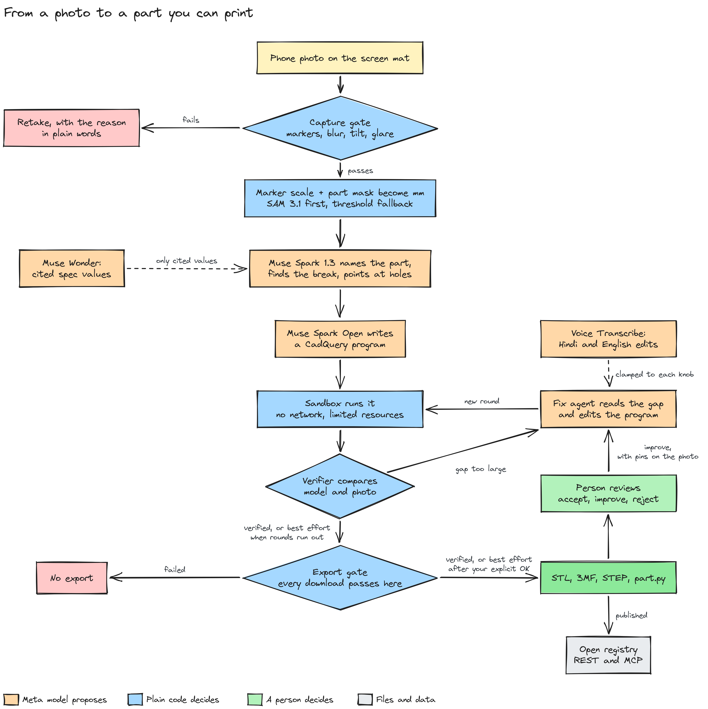

<details><summary>The same diagram as text</summary>

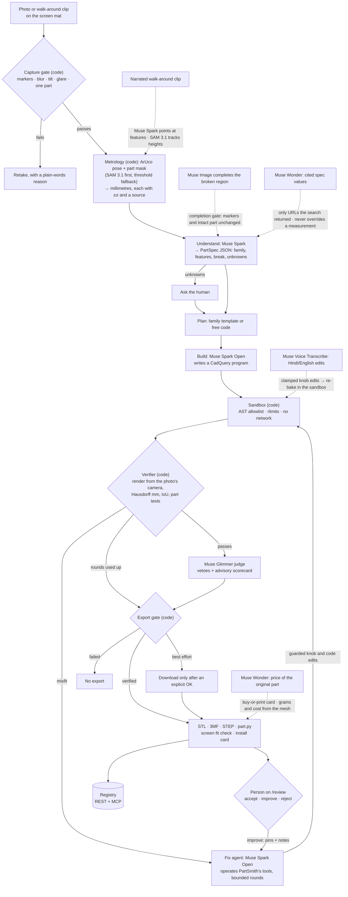

</details>

Solid arrows are the main pipeline; dotted arrows are side paths whose output code accepts only after a check. Boxes that
name a model are model calls; boxes marked "(code)" are deterministic, hand-written checks. The same diagram, with the
runtime layout (review, admin and spend-cap layers included), is in [`docs/ARCHITECTURE.md`](docs/ARCHITECTURE.md).

- **Screen mat.** The web app draws a ring of ArUco markers at true 1:1 scale on a laptop or tablet. You calibrate the scale once
  by matching an ID-1 bank card (85.60 × 53.98 mm). A plain-paper A4 mat PDF works too. Open the capture page on your phone with
  the QR code; the laptop follows the job live.
- **Measurement.** Sub-pixel marker corners → homography and camera pose → part mask (SAM 3.1 first, threshold fallback) → contour in mm with exact parallax
  correction for the part's thickness, circle/slot fitting, see-through hole fitting for thick parts, and an uncertainty per
  value. A 5–10 s walk-around clip gives heights a single top photo cannot. Sizes the photo cannot see (a hidden depth) can
  be typed on `/fix`: they are labelled "stated by you", used by the builder and checked against the program, never verified.
- **Broken parts.** The broken region is masked out of the comparison: the part is verified on its intact region only, and the
  missing piece comes from the template, your stated size, a cited spec or a gated Muse Image completion, each labelled.
- **Agent loop.** The fix agent can inspect residuals, measure a feature, cut out a point, render a candidate, run the part
  tests and set knobs. Rendering is free; committing a change costs one of six rounds and passes the same guards. Code
  stops the loop early after two rounds that leave the shortfall where it was, and the job page says which rule kept the
  final round.
- **Verified** means: all P0 part tests pass, Hausdorff ≤ 0.5 mm on every view, IoU ≥ 0.97 on views large enough for IoU to
  mean something, and no veto from the independent judge. Only the verifier can set it. A best-effort part says which
  check failed.
- **Screen fit check.** Before printing, the model's 1:1 outline is drawn on the calibrated screen. You lay the real part on it
  and photograph it, and the same verifier says pass or fail with an overlay. A fit-test coupon (the hole at −0.2, 0 and
  +0.2 mm) learns your printer's clearance.
- **Spend cap.** `PARTSMITH_DAILY_USD_CAP` stops live model calls for the rest of the UTC day once that day's spend reaches
  the cap; the job fails with a clear message rather than falling back silently. `/status` and the admin overview show
  today's spend against the cap.

### What a person does

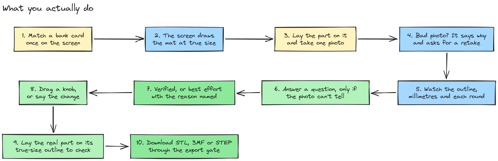

<details><summary>The same diagram as text</summary>

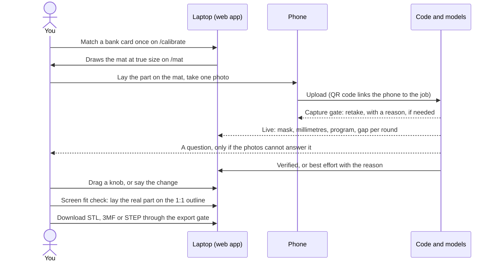

</details>

### The agent loop

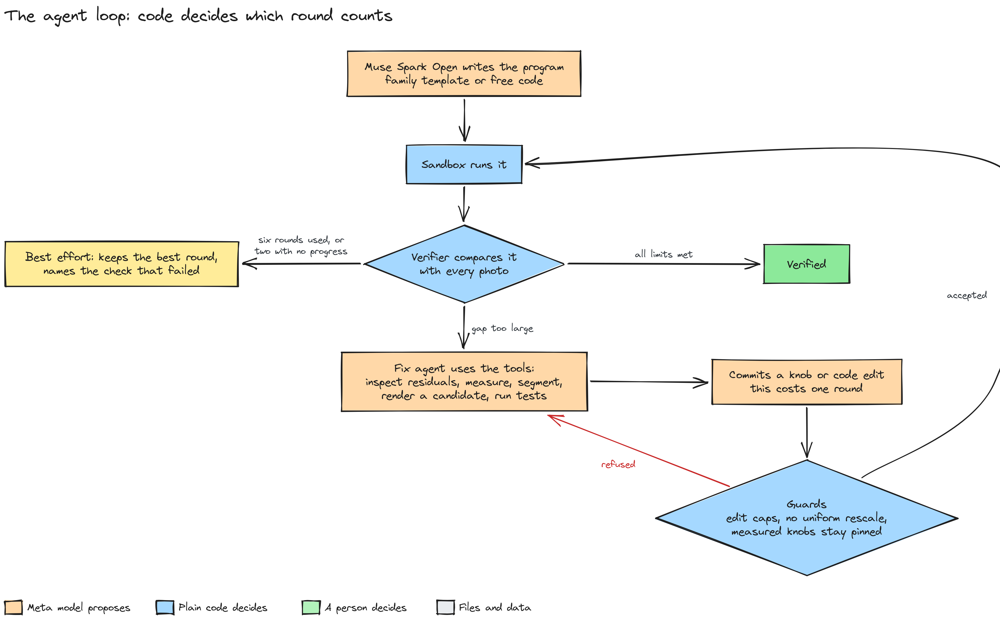

<details><summary>The same diagram as text</summary>

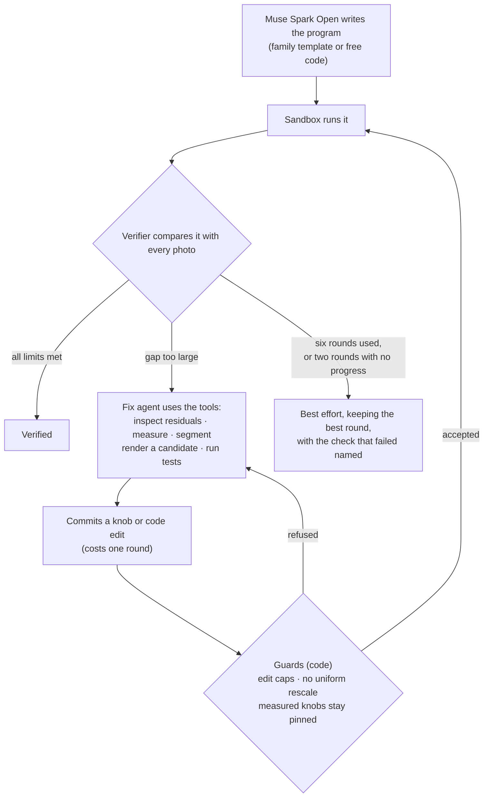

</details>

Rendering a candidate is free. Only a committed edit uses a round, and code decides which round is kept.

### System architecture

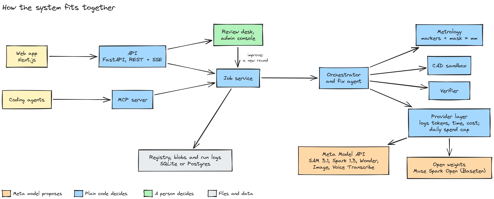

<details><summary>The same diagram as text</summary>

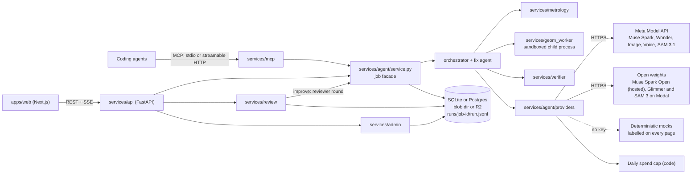

</details>

### Verification and the export gate

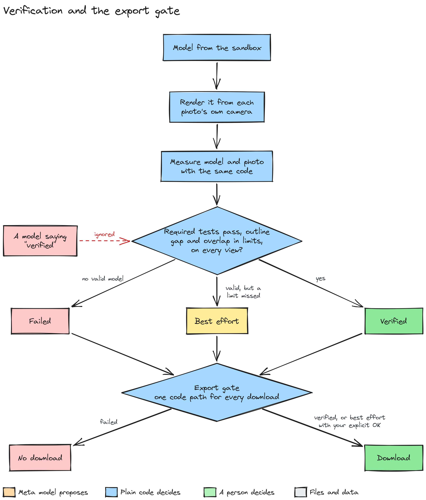

<details><summary>The same diagram as text</summary>

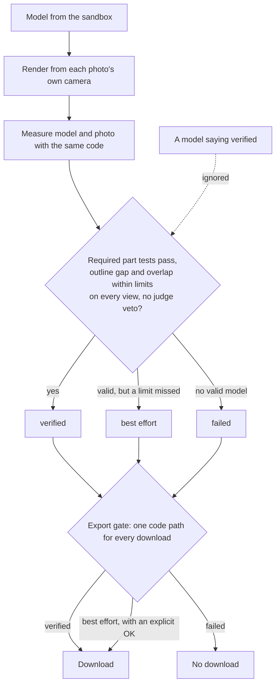

</details>

### Where a job's data goes

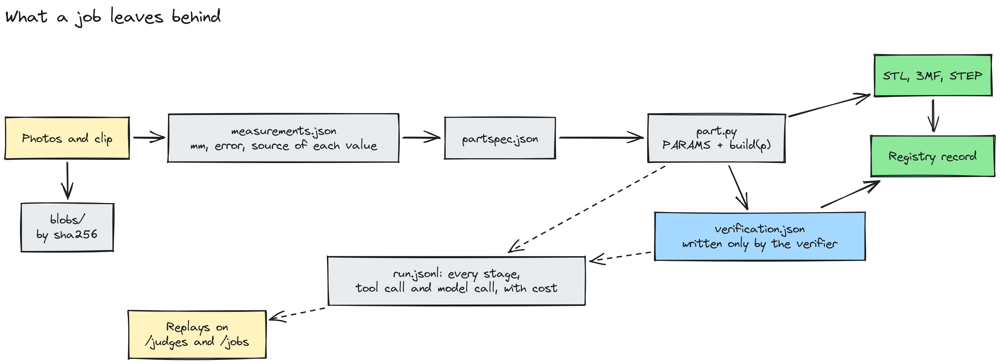

<details><summary>The same diagram as text</summary>

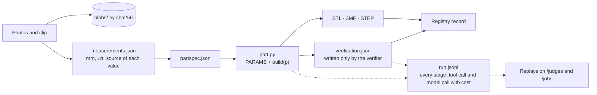

</details>

## Why trust a model-made part?

A language model can write a CAD file that looks right and is 2 mm off. For a replacement part, that is useless. PartSmith
never trusts what a model says about itself:

| A model proposes … | … and code decides | Where |
|---|---|---|
| A segmenter returns a mask (SAM 3.1, or the threshold fallback) | ArUco pose, parallax correction and sub-pixel edge fitting turn it into mm with an uncertainty per value; the capture gate rejects blurred, tilted, glary or multi-part photos | `services/metrology` |
| Muse Spark names a feature and the pixel it is at | SAM 3.1 cuts that point out, code fits the circle or slot in mm | `services/metrology/points.py` |
| Muse Spark Open writes and edits CadQuery | It runs in a sandbox (AST allowlist, rlimits, no network); guards cap each edit and refuse uniform rescaling | `services/geom_worker`, `services/agent/guards.py` |
| The fix agent proposes a knob edit | Refused if it moves a knob out of a measured size test that already passes, unless a failing residual or a failing view's worst spot points at it; the rounds stop after two that make no progress | `services/agent/guards.py`, `services/agent/orchestrator.py` |
| The fix agent says "done" | The verifier re-renders from the photo's camera and re-measures model and photo with the same code; only it sets `verified` | `services/verifier` |
| Muse Wonder quotes a spec | Accepted only if a web search ran and the URL came back from it; cited values never override a measurement | `services/agent/providers/spec.py` |
| Muse Image completes the broken region | Accepted only if every mat marker re-detects in place and the intact part is unchanged | `services/metrology/recon_gate.py` |
| Muse Glimmer judges the result | Veto only: it can block a pass, never grant one; its vetoes are shown with the model and mode that made them | `services/agent/orchestrator.py` |
| Muse Spark points at features while you narrate a clip | A point is kept only if it lands on the part in its own frame and on the measured footprint; the words steer, never set a number | `services/metrology/narration.py` |
| Muse Spark reads a typed description | Template names, knob names and values are mapped and clamped by code; a "you said" value whose quote is not in your text is downgraded; the result is "Matches your numbers", never "verified" | `services/registry/describe.py` |
| A search finds the original part's price | Kept only with the source link the search returned and a quote that shows the price; grams, print time and cost come from the mesh | `services/agent/providers/buy.py`, `services/agent/buy_or_print.py` |
| A tall part is seen only from above | The photo bounds its length and width instead of fixing them; without a side view or clip, code refuses to verify an extruded guess, and every knob nothing checked is listed as inferred | `services/verifier/verify.py` |
| Anyone asks to download | Every download URL gives a best-effort part only after an explicit "I understand" and refuses a failed one | `services/verifier/ship.py`, `services/registry/gate.py` |

The table below shows these checks being attacked (all numbers are written by scripts):

<!-- BEGIN:evidence -->
| Check | Result | Source |
|---|---|---|
| Intact parts, normal photos → accepted | 6/6 handled as expected, 95 % CI [0.61, 1.00] | `eval/reports/latest/report.json` → `tables.control` |
| Photos that must be rejected or refused | 10/10 handled as expected, 95 % CI [0.72, 1.00] | `eval/reports/latest/report.json` → `tables.redteam` |
| Verified synthetic parts that are > 0.5 mm off the ground truth | 0/2 (config PS) | `eval/reports/latest/report.json` → `tables.synthetic` |
| Verified reference objects that are > 0.5 mm off the ground truth | 0/4 (config PS) | `eval/reports/latest/report.json` → `tables.reference_objects` |
| Verified intact parts with only a top photo that are > 0.5 mm off the ground truth | 4/4 (config PS) | `eval/reports/latest/report.json` → `runs.control.PS` |
| Verified public photos that are > 0.5 mm off the ground truth | 2/6 (config PS) | `eval/reports/latest/report.json` → `runs.public_photos.PS` |
| Edit a hole: scale the mesh vs change the program's knob (17 parts, 88 edits) | hole spacing moved 2.771 mm (median) with mesh scaling, 0.0 mm with the knob | `eval/reports/latest/program_vs_mesh.md` |
| A model that lies or cheats (says verified, edits the record, loosens limits, rescales to fit, fakes a break, smuggles imports, exports without consent) | 17/17 attempts blocked by code | `eval/reports/latest/bypass.json` |
| Real repairs logged | pending: no sessions logged yet (data/impact/sessions.yaml) | `data/impact/sessions.yaml` |
<!-- END:evidence -->

## Results

Every number here is written by a script: `tools/readme.py` reads `eval/reports/latest/` and draws the charts, and
[docs/PROOF.md](docs/PROOF.md) lists what was tested and what was not. Ground-truth sources are never mixed: rendered photos
(exact), standard reference objects (published specs), real broken parts (school ruler, ±0.5 mm), and public photos of real
objects pasted on a rendered mat (published specs; not phone photos, and not counted as real photos measured).

### Charts

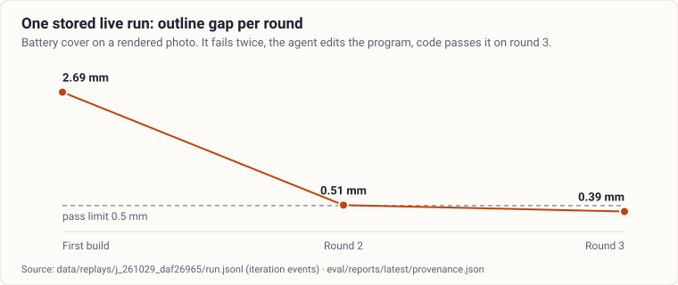

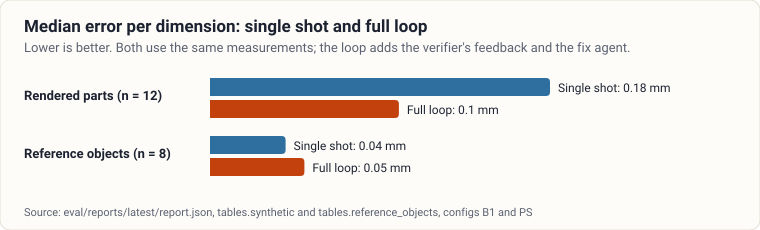

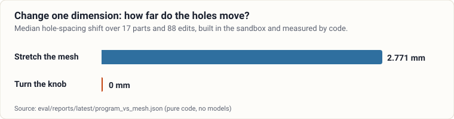

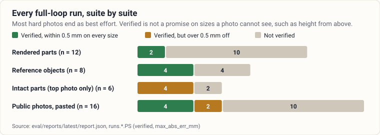

<details><summary>The bench's own charts: convergence and error distributions</summary>

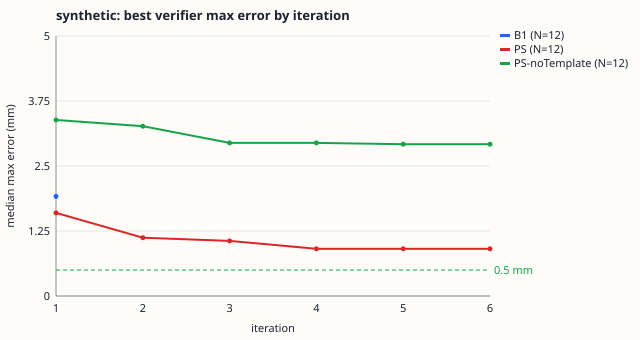
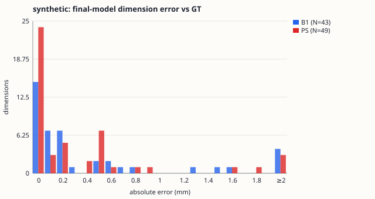
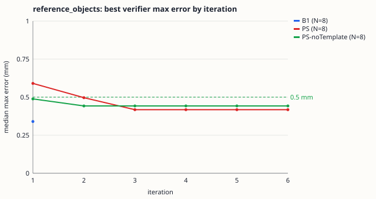
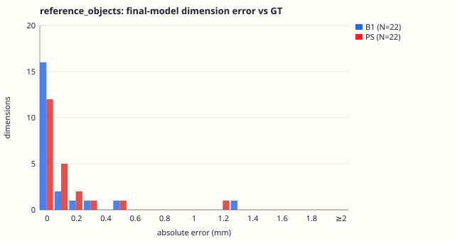
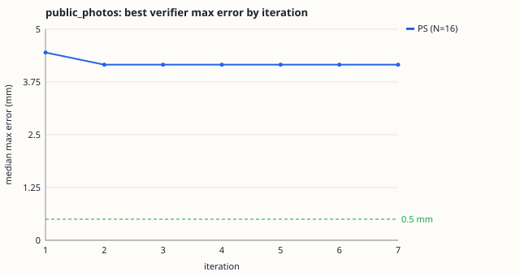
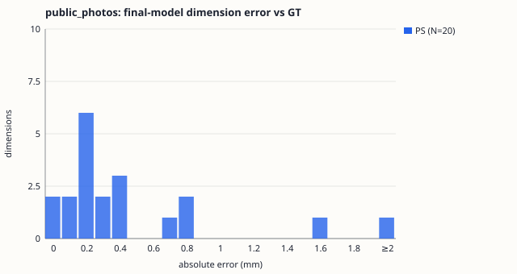

</details>

### Evaluation at scale

<!-- BEGIN:scale -->
**349 of 510 planned full runs** finished before the time limit, on photos rendered from fresh seeds, with the sizes and rules fixed first in [`eval/SCALE_PLAN.md`](eval/SCALE_PLAN.md). Runs were shuffled, so each suite is an unbiased subset. That took 8,081 live model calls, 62 million tokens and $78.01. **None of these photos is a real phone capture.** Nothing was rerun. Source: `eval/reports/latest/scale.json`.

| Suite | Config | n | Median error | Within 0.5 mm on every size | Verified | Verified but off |
|---|---|---|---|---|---|---|
| Rendered parts (exact ground truth) | B1 | 67 | 0.25 mm | 24 % [0.15, 0.35] | 2 % [0.00, 0.08] | 0/1 |
| Rendered parts (exact ground truth) | PS | 144 | 0.15 mm | 48 % [0.40, 0.56] | 28 % [0.21, 0.36] | 5/40 |
| Broken parts (exact ground truth) | PS | 16 | 0.103 mm | 19 % [0.07, 0.43] | 12 % [0.03, 0.36] | 2/2 |
| Reference objects, rendered (published sizes) | PS | 39 | 0.04 mm | 69 % [0.54, 0.81] | 44 % [0.29, 0.59] | 0/17 |

**The loop against a single shot, same photos:** 24 vs 11 of 44 pairs had every size within 0.5 mm (McNemar exact p = 0.0010).

**What a side photo does for wrong passes:** verified but more than 0.5 mm off was 10/13 (77 %, 95 % CI 50-92) with a top photo only, and 1/9 (11 %, 95 % CI 2-44) with top and side. Across all full-loop runs it was 18/81 (22 %, 95 % CI 15-32), 15 of them in height. A verified part from a top photo alone says nothing about its height.

**Expected outcomes:** intact parts handled correctly 26/26 (top only) and 27/27 (top and side); bad or unsuitable photos 27/30 (see the report).

**Voice edits, synthesised speech, correct edit:** 34/40 (85 %, 95 % CI 71-93) spoken and 39/40 (98 %, 95 % CI 87-100) typed. By language, spoken: english 14/14, hindi 7/12, mixed 13/14. Pure Hindi is the weak spot.

**Muse Wonder:** code accepted a cited value on 24/30 (80 %, 95 % CI 63-90). A citation is not a verified fact: of the pages checked, the number was found on 7, and 5 pages could not be read.

#### Mask sources

SAM 3.1 is asked first, and code's threshold segmenter takes over when it returns nothing confident. With the prompt "plastic part", SAM returned a usable mask on 38/494 (8 %, 95 % CI 6-10) of rendered top photos. When it did, the median overlap with ground truth was 0.97 and the median boundary error 0.43 mm.

| Suite | Threshold measured | SAM 3.1 measured | No measurement (rejected) |
|---|---:|---:|---:|
| broken | 14 | 2 | 0 |
| control_side | 26 | 1 | 0 |
| control_top | 25 | 1 | 0 |
| redteam | 10 | 0 | 20 |
| reference_objects | 35 | 0 | 4 |
| synthetic | 172 | 19 | 20 |

**The fix, after that evaluation.** The phrase was the problem: code now reads the part's colour and asks for, say, "orange plastic part" first. On 147 photos (`eval/reports/latest/sam_prompts.json`) SAM returned a usable mask on 5 before and 91 after. Its median overlap with the exact mask is 0.982, against 0.956 for the threshold. It still measures a little worse: median length and width error 0.196 mm against 0.152 mm, and hole diameter 0.238 mm against 0.128 mm. Public photos of real objects barely moved, 1 of 16. These photos are rendered or pasted; real phone photos are untested. The evaluation above ran before this change, so its mask counts describe the old prompt.

A live job on the battery cover after the fix measured from SAM's mask and verified at 0.25 mm in 2 rounds, for $0.23: the stored run is `data/replays/j_261105_92a408c2`, and `/jobs/j_261105_92a408c2` on the site.
<!-- END:scale -->

### Bench tables

`B1` is a single shot with the mat's measurements; `PS` is the full loop; `PS-noTemplate` is the loop without the template
library. `pass@0.5` means every size within 0.5 mm of the ground truth.

<!-- BEGIN:bench -->
Generated 2026-11-04T21:36:46+00:00 at commit `1f77aad30f748b303ab28a048e362a72929fe3d1` · mode **live**.

**Synthetic bench (exact ground truth)**

N = 12 · photos: synthetic renders · ground truth: `synthetic_exact` · CI: 95 %: bootstrap over samples (2000 resamples, seeded) for mean errors; Wilson for rates

| config | n | median_abs_err_mm | mean_abs_err_mm | mean_ci95 | pass@0.5 | verified_rate | verified_but_off | median_iters | usd_per_job |
|---|---|---|---|---|---|---|---|---|---|
| B1 | 12 | 0.18 | 0.856 | [0.313, 1.674] | 0.083 | 0.083 | 0/1 | 1 | $0.0681 |
| PS | 12 | 0.1 | 0.604 | [0.221, 1.196] | 0.25 | 0.167 | 0/2 | 6 | $0.2091 |
| PS-noTemplate | 12 | 0.23 | 0.914 | [0.481, 1.574] | 0.083 | 0.167 | 1/2 | 4.5 | $0.2130 |

_headline = PS on the held-out split (12 samples)_

**Reference objects (vs published specs)**

N = 8 · photos: synthetic renders · ground truth: `reference_spec` · CI: 95 %: bootstrap over samples (2000 resamples, seeded) for mean errors; Wilson for rates

| config | n | median_abs_err_mm | mean_abs_err_mm | mean_ci95 | pass@0.5 | verified_rate | verified_but_off | median_iters | usd_per_job |
|---|---|---|---|---|---|---|---|---|---|
| B1 | 8 | 0.04 | 0.142 | [0.027, 0.330] | 0.75 | 0.25 | 0/2 | 1 | $0.0492 |
| PS | 8 | 0.05 | 0.155 | [0.052, 0.303] | 0.75 | 0.5 | 0/4 | 2.5 | $0.1631 |
| PS-noTemplate | 8 | 0.066 | 0.159 | [0.049, 0.336] | 0.75 | 0.5 | 0/4 | 2.5 | $0.2073 |

_headline = PS on the held-out split (8 samples)_

**Real broken parts (vs school ruler, ±0.5 mm)**

_Pending — no real parts with ruler ground truth yet (data/real/<part>/gt.yaml, see eval/REPRODUCE.md)._

**Public photos of real objects, pasted on a rendered mat (vs published spec; not phone photos, not counted as real photos measured)**

N = 16 · photos: public photos of real objects, cut out and pasted on a rendered mat · ground truth: `published_spec_pasted` · CI: 95 %: bootstrap over samples (2000 resamples, seeded) for mean errors; Wilson for rates

| config | n | median_abs_err_mm | mean_abs_err_mm | mean_ci95 | pass@0.5 | verified_rate | verified_but_off | median_iters | usd_per_job |
|---|---|---|---|---|---|---|---|---|---|
| PS | 16 | 0.308 | 0.522 | [0.317, 0.834] | 0.625 | 0.375 | 2/6 | 3 | $0.1973 |

_Not phone captures and not counted as real photos measured: each object is cut out of a public photograph by code and pasted on our rendered screen mat, so the mat, the camera and the lighting on the mat are rendered. The paste scale is set from one published dimension (the long side); that dimension is excluded from every error, so only the other dimensions and features are held out. It says nothing about a phone photographing a laptop screen; headline = PS on the held-out split (16 samples); Measure only, no model: capture gate passed 16/16, held-out mean abs error 0.432 mm (95 % CI 0.296 to 0.603), n = 21; Flat-plane marker fit on real camera photos of printed boards: 0.138 % of span on held-out corners (95 % CI 0.108 to 0.178, n = 48, 2 photos)_

**Public photos, measure only (no model).** Capture gate passed 16/16. Held-out dimensions: mean abs error 0.432 mm (95 % CI 0.296 to 0.603), n = 21. The dimension that set the paste scale is excluded. `eval/reports/latest/public_photos_measure.md`

**Real-camera scale check (public photos of printed boards).** A flat-plane fit to the outer markers predicts the inner corners to 0.138 % of span (95 % CI 0.108 to 0.178, n = 48 corners in 2 photos), 0.138 mm over a 100 mm span. It says nothing about a phone photographing a laptop screen. `eval/reports/latest/public_scale.md`

**Measurement only (photo → mm, no CAD loop)**

```
synthetic                        photos 120 accepted  97  dims N=228  mean 0.468 [0.370, 0.580]  median 0.200  P90 1.039  max 5.316  ≤0.5 77 %
  top view, flat parts                   dims N= 82  mean 0.226 [0.181, 0.273]  median 0.165  P90 0.544
  top view, parts with tall features     dims N= 98  mean 0.494 [0.324, 0.690]  median 0.129  P90 1.378
  expected rejections (white part on light stage): 5/6 correctly rejected
reference_objects_synthetic      photos  30 accepted  21  dims N= 35  mean 0.178 [0.114, 0.264]  median 0.087  P90 0.307  max 1.312  ≤0.5 91 %
reference_objects_real           pending (no photos)
real_parts_ruler                 pending (no photos)
EXIT GATE (mean ≤ 0.4 mm): synthetic 0.468 FAIL · reference objects [reference_objects_synthetic] 0.178 PASS → FAIL
```
<!-- END:bench -->

### Every verified part against ground truth

<!-- BEGIN:audit -->
| Suite | Full-loop runs | Verified | Within 0.5 mm on every size | Off by more than 0.5 mm |
|---|---|---|---|---|
| Rendered parts | 12 | 2 | 2 | 0 |
| Reference objects (renders) | 8 | 4 | 4 | 0 |
| Intact parts, top photo only | 6 | 4 | 0 | 4 |
| Public photos, pasted on a rendered mat | 16 | 6 | 4 | 2 |
| Bad or unsuitable photos | 10 | 0 | 0 | 0 |

Before the public photos, the full loop verified **10** parts, and **4** of them were more than 0.5 mm off on some dimension. **3** of those were in height, on intact parts with only a top photo, which cannot see height. The public-photo suite adds **2 of 6**. So "verified" means the model matches the photos it was given within the limits below. It is not a promise on sizes those photos cannot see, and a size no check compared with a photo is listed as inferred.

<details><summary>Every verified run</summary>

| Suite | Sample | Worst error on any size | Note |
|---|---|---|---|
| Rendered parts | `syn-caster-wheel-tilt-s108404` | 0.179 mm | within limit |
| Rendered parts | `syn-spacer-blur-s21267` | 0.1 mm | within limit |
| Reference objects (renders) | `ref-id1-card-clean-s787514` | 0.395 mm | within limit |
| Reference objects (renders) | `ref-id1-card-tilt-s330647` | 0.04 mm | within limit |
| Reference objects (renders) | `ref-sd-card-clean-s596360` | 0 mm | within limit |
| Reference objects (renders) | `ref-sd-card-tilt-s997355` | 0.05 mm | within limit |
| Intact parts, top photo only | `ctl-cable-clip-s447475` | 0.6 mm | worst length -0.60 mm |
| Intact parts, top photo only | `ctl-clip-s55909` | 7.9 mm | worst thickness -7.90 mm |
| Intact parts, top photo only | `ctl-cupboard-latch-s844149` | 0.8 mm | worst thickness -0.80 mm |
| Intact parts, top photo only | `ctl-spacer-s435219` | 0.651 mm | worst thickness -0.65 mm |
| Public photos, pasted on a rendered mat | `id1_card-1` | 0.276 mm | within limit |
| Public photos, pasted on a rendered mat | `microsd_card-1` | 0.419 mm | within limit |
| Public photos, pasted on a rendered mat | `sd_card-10` | 0.339 mm | within limit |
| Public photos, pasted on a rendered mat | `sd_card-2` | 0.188 mm | within limit |
| Public photos, pasted on a rendered mat | `sd_card-8` | 0.818 mm | worst width +0.82 mm |
| Public photos, pasted on a rendered mat | `us_dime-1` | 0.838 mm | worst width -0.84 mm |

</details>
<!-- END:audit -->

### Why runs ended where they did

<!-- BEGIN:failures -->
| Suite | Config | Runs | `seg_fail` | `scale_fail` | `capture_reject` | `codegen_error` | `topology_wrong` | `dim_off` | `timeout` | `refused` | `judge_veto` |
|---|---|---|---|---|---|---|---|---|---|---|---|
| Intact parts, top photo only | PS | 6 | 0 | 0 | 0 | 0 | 1 | 4 | 0 | 0 | 0 |
| Public photos, pasted on a rendered mat | PS | 16 | 0 | 0 | 0 | 0 | 1 | 3 | 1 | 0 | 1 |
| Reference objects (renders) | B1 | 8 | 0 | 0 | 0 | 0 | 0 | 2 | 0 | 0 | 0 |
| Reference objects (renders) | PS | 8 | 0 | 0 | 0 | 0 | 0 | 2 | 0 | 0 | 0 |
| Reference objects (renders) | PS-noTemplate | 8 | 0 | 0 | 0 | 0 | 0 | 2 | 0 | 0 | 0 |
| Rendered parts | B1 | 12 | 1 | 0 | 1 | 0 | 1 | 8 | 0 | 0 | 0 |
| Rendered parts | PS | 12 | 1 | 0 | 1 | 0 | 0 | 7 | 0 | 0 | 0 |
| Rendered parts | PS-noTemplate | 12 | 1 | 0 | 1 | 0 | 2 | 7 | 0 | 0 | 0 |

`seg_fail`: no usable part mask · `scale_fail`: no scale from the mat (markers / reprojection / marker size) · `capture_reject`: capture gate rejected the photo (blur, glare, moiré, tilt, exposure, contrast) · `codegen_error`: no runnable or valid final part program · `topology_wrong`: features missing or extra in the final model · `dim_off`: a named dimension is outside tolerance · `timeout`: wall-clock or cost cap reached · `refused`: the part class was refused · `judge_veto`: a blocking judge veto on the final model.
<!-- END:failures -->

### Every limit the code applies

<!-- BEGIN:thresholds -->
**Pass rule (`services/verifier`)**

| Limit | Value | Meaning |
|---|---|---|
| `HAUSDORFF_PASS_MM` | 0.5 | Largest allowed outline gap between model and photo, on every compared view |
| `IOU_PASS` | 0.97 | Smallest allowed overlap (IoU) on views whose short side is at least 20 mm |
| `FEATURE_TOL_MM` | 0.15 | Allowed error on a measured feature such as a hole diameter |
| `BBOX_TOL_MM` | 0.3 | Allowed error on the overall outline length and width |
| `MIN_WALL_MM` | 0.8 | Thinnest wall a printable part may have |

**Capture gate (`services/metrology/capture_gate.py`), checked before any paid call**

| Limit | Value | Meaning |
|---|---|---|
| `BLUR_FAIL` | 2.5 | Marker-edge sharpness below this rejects the photo |
| `BLUR_WARN` | 4.0 | Marker-edge sharpness below this warns |
| `CLIP_FAIL` | 0.05 | Share of clipped pixels on the stage that rejects the photo |
| `CLIP_FLAT_STD` | 2.0 | Local grey-level spread under which a clipped area counts as carrying no texture |
| `CLIP_HIGH` | 250 | Grey level at or above which a pixel counts as blown out |
| `CLIP_LOW` | 5 | Grey level at or below which a pixel counts as crushed |
| `CLIP_WARN` | 0.02 | Share of clipped pixels on the stage that warns |
| `CONE_CHROMA_TOL` | 16.0 | Colour distance under which a part counts as shadow-coloured |
| `CONE_MIN_RATIO` | 0.5 | Brightness ratio under which a shadow-coloured part cannot be told from its shadow |
| `CONTRAST_FAIL_WEAK` | 0.2 | Share of weak part edges that rejects the photo |
| `CONTRAST_MIN_LARGEST_FRACTION` | 0.85 | Share of the part the largest piece must hold, or the mask is fragmented |
| `CONTRAST_MIN_SEPARATION` | 20.0 | Grey-level gap needed between part and stage |
| `CONTRAST_MIN_SOLIDITY` | 0.25 | Smallest solidity for a mask to count as one part |
| `CONTRAST_WARN_WEAK` | 0.08 | Share of weak part edges that warns |
| `EDGE_MIN_CONTRAST` | 20.0 | Grey-level step for an edge to count as strong |
| `GLARE_FAIL_MARKERS` | 3 | Number of glared markers that rejects the photo |
| `GLARE_MARKER_DARK_FRACTION` | 0.15 | Share of a marker's black cells blown out for it to count as glared |
| `GLARE_MIN_BLOB_MM2` | 4.0 | Smallest bright blob that counts as glare on the stage (mm²) |
| `GRID_CELLS` | 7 | Cells per side of an ArUco marker |
| `MIN_MARKERS_WARN` | 4 | Fewer detected markers than this warns |
| `MIN_PART_AREA_MM2` | 10.0 | Smallest part area accepted (mm²) |
| `MOIRE_FAIL` | 5.0 | Periodic screen pattern strength that rejects the photo (rms grey levels) |
| `MOIRE_PEAK_RATIO` | 25.0 | Spectral peak over its ring's median for a pattern to count as periodic |
| `MOIRE_WARN` | 2.0 | Periodic screen pattern strength that warns (rms grey levels) |
| `PATCH_PX_PER_CELL` | 8 | Pixels per marker cell when a marker is rectified for checking |
| `REPROJ_FAIL_PX` | 2.0 | Marker reprojection error that rejects the photo |
| `REPROJ_WARN_PX` | 1.0 | Marker reprojection error that warns |
| `SCALE_FAIL` | 0.03 | Disagreement in marker size across the mat that rejects the photo |
| `SCALE_WARN` | 0.015 | Disagreement in marker size across the mat that warns |
| `SINGLE_PART_MIN_MM2` | 20.0 | Size above which a second object on the stage counts |
| `SINGLE_PART_REL` | 0.05 | Size relative to the largest object above which a second object counts |
| `STAGE_EDGE_MARGIN_MM` | 1.0 | Distance the part must keep from the stage edge |
| `TILT_FAIL_DEG` | 25.0 | Camera tilt that rejects the photo |
| `TILT_WARN_DEG` | 15.0 | Camera tilt that warns |
<!-- END:thresholds -->

### Test gates

<!-- BEGIN:gates -->
Last run 2026-11-04T23:08 UTC. Details: [docs/PROOF.md](docs/PROOF.md).

| Gate | Command | Result | Took |
|---|---|---|---|
| Backend unit tests (pytest) | `make test` | **passed** (1023 passed) | 275 s |
| Web unit tests (node --test) | `pnpm -s test (in apps/web)` | **passed** (153 passed) | 1 s |
| Browser tests (Playwright) | `pnpm -s exec playwright test --workers=2 (after next build)` | **passed** (273 passed, 279 skipped) | 303 s |
| Deploy configuration check | `make deploy-check` | **passed**  | 0 s |
| Python lint and format (ruff) | `make lint` | **passed**  | 0 s |
| Python types (mypy --strict) | `make typecheck` | **failed**  | 5 s |
| Web types (tsc) | `pnpm -C apps/web -s typecheck` | **passed**  | 2 s |
| Web lint (eslint) | `pnpm -C apps/web -s lint` | **passed**  | 4 s |
<!-- END:gates -->

## Verify it yourself

Nothing below asks you to trust this page. Unless a row says otherwise, it needs no key and makes no model call.

**Set up.** You need Python 3.12 with [uv](https://docs.astral.sh/uv/), Node 22 and pnpm. `make setup` takes a few minutes
the first time.

### Five-minute path

| # | Command or page | Expect | Takes |
|---|---|---|---|
| 1 | `make lie` | A scripted model says VERIFIED. The verifier prints the real max error against the limit, then `export BLOCKED`, then `make lie: OK` | Seconds |
| 2 | `make deploy-check` | Static checks of the deploy files pass, including that no secret or private file can enter the image | Seconds |
| 3 | `make bench` | Every results table rebuilt from stored runs, with `tables rebuilt from … stored run(s)` in the report's notes | Under a minute |
| 4 | `uv run python -m tools.readme && git diff --stat README.md` | The README's generated numbers match the reports: no change beyond dates and the commit list | Seconds |
| 5 | `make dev`, then `/judges` | A stored live run replayed from its log, and *A lying model, caught* | About a minute to start |

### Check each headline number against its file

| Number | Command |
|---|---|
| Lying-model attacks blocked | `python3 -c "import json;d=json.load(open('eval/reports/latest/bypass.json'));print(d['blocked'],'of',d['attempts'])"` |
| Verified parts off by more than 0.5 mm | `python3 -c "import json;r=json.load(open('eval/reports/latest/report.json'));[print(k,sum((x.get('max_abs_err_mm') or 0)>0.5 for x in v.get('PS',[]) if x.get('verified')),'of',sum(1 for x in v.get('PS',[]) if x.get('verified'))) for k,v in r['runs'].items()]"` |
| Control and red-team results | `python3 -c "import json;r=json.load(open('eval/reports/latest/report.json'));print(r['tables']['control']['headline'],r['tables']['redteam']['headline'])"` |
| Median error, rendered parts | `python3 -c "import json;print(json.load(open('eval/reports/latest/report.json'))['tables']['synthetic']['headline'])"` |
| Share of builder calls on open weights | `python3 -c "import json;b=json.load(open('eval/reports/latest/open_weights.json'))['builder'];print(b['calls_on_open_weights'],'of',b['calls'])"` |
| The battery-cover run's rounds | `python3 -c "import json;[print(e['iter'],round(e['hausdorff_mm'],2)) for e in map(json.loads,open('data/replays/j_261029_daf26965/run.jsonl')) if e.get('t')=='iteration']"` |

### Check each guarantee

| Guarantee | How to check it | Where the code is |
|---|---|---|
| Only the verifier can mark a part verified, and a tampered record is refused | `uv run pytest services/verifier/tests/test_functional_ship.py -q` | `services/verifier/verify.py`, `services/verifier/ship.py` |
| Every download goes through one gate | `uv run pytest services/api/tests -q -k "ship or gate or export"`; then, with `make dev` running, ask for a best-effort part's STL without `ack` and get a refusal | `services/registry/gate.py` |
| A lying model is caught | `uv run python -m eval.bypass`, then read `eval/reports/latest/bypass.json`: each attack with its claim, what code measured and the layer that stopped it | `eval/bypass.py` |
| Model-written CAD cannot reach the network, escape or exhaust the machine | `uv run pytest services/geom_worker/tests/test_sandbox.py services/geom_worker/tests/test_policy.py -q`: imports refused, a loop timed out, a memory bomb stopped, the network blocked | `services/geom_worker/sandbox.py`, `policy.py` |
| Spend stops at the daily cap | `uv run pytest services/agent/providers/tests/test_budget.py -q` | `services/agent/providers/budget.py` |
| No key leaks into git, logs or the image | `make gitleaks`; `uv run pytest services/agent/providers/tests/test_config_routing.py services/agent/providers/tests/test_complete.py -q -k "redact or key"`; `make deploy-check` | `services/agent/providers`, `infra/deploy/check.py` |
| Replays are labelled, and mock stages say so | Open `/models` and any `/jobs/...` page in replay mode: every stage shows its mode | `services/agent/providers/routing.py` |
| Test reviews never count as a person's | `uv run pytest services/review -q -k "test_review or by or agreement"` | `services/review` |

### Check the public-photo evidence

These are real photographs of real objects, cut out by code and pasted on our rendered mat, so they check segmentation and
the loop on real surfaces. They are not phone captures of a laptop screen.

| Check | Command | Needs |
|---|---|---|
| Measure only, no model | `uv run python -m eval.public_photos` | Nothing; the photos are in `data/public_photos/` |
| Re-score stored live runs | `make bench`, then read `separate_tables.public_photos` in `report.json` | Nothing |
| Re-run live | `PROVIDER_MODE=live uv run python -m eval.run --live --suite public_photos --max-usd 5` | A Meta and a Baseten key, and real money |
| Marker scale on real camera photos | Read `eval/reports/latest/public_scale.json` and `.md`: per-photo results, the excluded board and why. Re-running `uv run python -m eval.public_scale` needs public camera photos of printed marker boards in `var/public_photos/raw/scale`, which are not stored here | The stored report needs nothing |

Rules and caveats: the paste scale comes from one published dimension, which is left out of every error; see
[eval/REPRODUCE.md](eval/REPRODUCE.md).

### Run the whole thing

| Command | What it does | Needs | Takes |
|---|---|---|---|
| `make test` | Backend unit tests, with no network | Nothing | Minutes |
| `make typecheck`, `make lint` | mypy strict, ruff | Nothing | Seconds |
| `pnpm -C apps/web typecheck`, `lint`, `test` | Web types, lint and unit tests | Nothing | Seconds |
| `make e2e` | Browser tests against a built web app | Nothing | Minutes |
| `make proof` | All gates, into `eval/reports/latest/tests.json` and `docs/PROOF.md` | Nothing | Several minutes |
| `uv run python -m eval.rebake` | Re-times a knob change | Nothing | Seconds |
| `make smoke` | One call per provider, printing live, mock or failed | Keys, for live | Seconds |
| `partsmith fix <folder>` | One job from the command line | Keys, for live; mocks without | Minutes |
| `make bench-live` | Re-runs the benches on live models | Keys and real money | Hours |

More: [docs/PROOF.md](docs/PROOF.md), [eval/REPRODUCE.md](eval/REPRODUCE.md).

## Judging criteria and where to check each one

<!-- BEGIN:rubric -->
| Criterion | What we claim | Check it here |
|---|---|---|
| **Impact**: who benefits, could people use it | A broken plastic part stops meaning a thrown-out appliance: no caliper, no CAD, no printer of your own. One stored run takes 7.45 min and about ₹2.93 of filament by estimate. Not yet shown: real phone photos and real prints | [The problem](#the-problem-and-who-it-serves), [Time](#how-long-it-takes-and-why-it-works), [Limitations](#limitations), `/requests`, `/shop` |
| **Use of Meta AI tooling**: beyond a basic integration | SAM 3.1 asked first for the part mask, with a logged code fallback, and video tracking for heights; Muse Spark names features and points at pixels, and SAM 3.1 cuts them; Muse Spark Open writes programs and operates our tools (918 of 919 builder calls on open weights); Muse Wonder's citations are checked by code; Muse Image completions must leave the markers and intact part unchanged; Voice Transcribe hears Hindi and English mixed, with knob names as keywords | [Meta models](#what-was-not-possible-before-and-how-metas-models-made-it-possible), `eval/reports/latest/open_weights.json`, `/models` |
| **Technical depth: real objects** | 16 public photos of real objects, pasted on a rendered mat: median error 0.308 mm against published sizes. Not phone captures | `eval/reports/latest/report.json` → `separate_tables.public_photos`, `eval/REPRODUCE.md` |
| **Technical depth and execution** | A deterministic verifier is the only writer of `verified`; sandboxed CAD; one export gate; 1023 backend tests; 17/17 lying-model attacks blocked; mesh vs knob measured over 17 parts | [Verify it yourself](#verify-it-yourself), [Results](#results), [docs/DECISIONS.md](docs/DECISIONS.md) |
| **Demo**: works, holds up live, good to watch | `/judges` replays a stored live run and shows a lying model being caught, with no login and no keys. The demo film walks the same flow | [Try it](#try-it-in-2-minutes), the link row at the top |
| **Bonus: open weights** | Muse Spark Open on partner inference writes and fixes every program: 100 % of builder tokens. Muse Glimmer is wired for an own-GPU path but ran as a labelled mock in the stored bench, so it is not claimed | `eval/reports/latest/open_weights.json`, `infra/modal/` |
| **Bonus: agentic** | The fix agent reads residuals, measures, renders candidates, runs tests and sets knobs within bounded rounds, and code judges the result | job page Agent tab, `services/agent/agent_loop.py` |
| **Bonus: creative** | Muse Image completes the broken region under a code gate, previews the repair and draws the install card, always labelled as AI images | `services/metrology/recon_gate.py`, `services/media/preview.py` |
| **Bonus: viral, community vote** | Decided by the post and the gallery, not by this repo | the submission page |
<!-- END:rubric -->

## Limitations

Plainly:

- **Real phone photos measured: none yet**, and real parts with ruler ground truth: none. The bench uses rendered photos and
  public photos pasted on a rendered mat. Capture with a phone on a laptop screen is built and tested on renders, not yet on
  real photos. The tools for that day are ready (`make real-intake`, `make real-check`).
- **Real prints: none.** No part has been printed and fitted. The physical check offered today is the screen fit check, and
  its example page is labelled as an example.
- **Person reviews.** The stored review chain on `/review` is a scripted test and is labelled so. Judge-vs-person agreement
  stays near empty until people review; its count on the page comes from the real log.
- **Most hard photos do not verify.** See [the suite table](#every-verified-part-against-ground-truth). A best-effort part says
  which check failed and needs an explicit OK to download.
- **Verified parts can be off on what a photo cannot see.** The same table lists every verified part that missed the ground
  truth. Most were height from a top-only photo, which is why the side photo and the walk-around clip exist.
- **Muse Glimmer ran as a labelled mock in the stored bench.** Its code path and Modal deployment are written, but it has not
  run live in these numbers. So the judge's role in the stored runs is the mock's, and the README does not claim it. The
  all-open-weights row is pending for the same reason.
- **Public photos** are pasted on a rendered mat, and their masks were corrected after a first pass; the first-pass number is
  kept in `eval/reports/latest/public_photos_measure_first_pass.json`.
- **The status line** says whether the numbers come from mock or live providers. With mock providers they check the pipeline,
  verifier and scorer, and do not measure any model. Some stages in the live tables ran as labelled mocks: see
  `provider_modes`.
- A single top photo cannot resolve heights above the stated plate thickness; raw top-view measurements of tall features are
  biased (see the measurement-only table).
- White or light-grey parts need the dark screen stage; the capture gate asks for it.
- Flexible parts (rubber seals, gaskets) and free-form objects (figurines, sculptures) are refused with a reason, as are
  safety-critical classes: a rigid parametric model cannot replace them.

## Key decisions

The full log, one paragraph per decision and newest last, is in [docs/DECISIONS.md](docs/DECISIONS.md). The ones that shape
the product:

| Decision | Why | Log entry |
|---|---|---|
| Code decides, and the model only proposes | A model that grades itself will say it passed. Only `services/verifier` writes `verified` | "A claimed break is an attack surface" |
| Programs, not meshes | A mesh stretched to fit moves its holes; a knob does not | Program vs mesh report |
| The screen is the mat | Nobody needs a printer, caliper or special paper; a card calibrates it once | "Screen mat first, plain-paper mat second" |
| Untrusted CAD runs in a sandboxed child process | LLM-written code never runs in the API process | "One CPU Python environment, process isolation for untrusted code" |
| One routing table with fallback chains | Each stage can change provider in one place, and each call logs its cost | "Stage routing and fallback chains" |
| A daily spend cap at the provider layer | A public site cannot run up a bill, and it fails loudly rather than silently falling back | "A daily spend cap at the provider layer" |
| Reviewer notes become rules only with a person's tick | A model does not teach itself from its own output | "Reviewer notes become family rules only with a person's tick" |
| Realtime voice relayed by the API | The key never reaches the browser | "Realtime voice is relayed by the API" |
| Public photos kept apart from real photos | They are evidence about surfaces, not about phone capture, and never count as real photos measured | "Public photos as evidence, kept apart from real photos" |

## Human review

Code decides whether a part matches the photo; only a person knows what the photo cannot show (the corner was square, this
hole takes an M3 screw). Every finished job waits on `/review` with the photo and the model side by side, the verifier's
numbers, the judge's scorecard and vetoes (with the model and mode that made them), each agent's calls and the cost.

- **Accept (A)** records a person's sign-off next to the verdict, never instead of it. An accepted part that the
  verifier did not pass publishes as "best effort, accepted by a person".
- **Improve (I)**: click the photo where something is wrong and say what. A reviewer round starts from that model (no new
  reading or plan): the fixer gets each note, a photo | model crop with the pin drawn as a numbered ring, and the
  local mismatch code measures at the pin. It comes back as the next round with each pin's mismatch before → after.
- **Reject (R)** with a reason, kept as a lesson candidate.
- **Paste a screenshot** (Ctrl+V) or drop a picture of how the part should look; it goes to the fixer with the notes.
- **Feedback log** (`/review/log`): every send-back and rejection, grouped by part, with what was wrong, *why it matters*
  (the reviewer's reason), a close-up of the pinned spot and what code measured in the next round (fixed, better, not
  fixed). A person's feedback measured as fixed, with its reason, is given to later jobs of the same family; each entry
  shows how later reviews of those jobs went, so a lesson that does not hold is visible.
- **Memory.** On accept, Muse Spark drafts one general rule per note for the part's family; the reviewer edits and ticks
  them. Only ticked rules reach future builder and fixer prompts for that family, each with the job it came from, and
  `/lessons` shows how later reviews of jobs that used a rule went. An admin can switch a taught rule off on `/admin`.
- **Who reviewed.** Every decision says whether a person made it or it was a scripted test; tests never promote a rule,
  publish a part or count toward agreement. The recorded hinge-leaf chain on `/review` is a labelled test chain.
- **Judge vs person.** The judge's 1–5 scorecard is advice; it sees the photos, the model's silhouettes and a shaded 3D
  view, because a silhouette cannot show a rolled barrel or a countersink. `/review` counts how often it agreed with the
  reviewer (Cohen's κ from the stored reviews, with the number of reviewers).

## Admin console

`/admin` (admin token when `PARTSMITH_ADMIN_TOKEN` is set; open in development mode, and the page warns about it):

- **Overview**: jobs made here and recorded, pass rate, rounds to verify, max-error median and P90, why people sent parts
  back, review states, registry and request counts, cost by stage and model, and today's spend against the cap. Every
  block is computed by `services/admin` from stored data and carries its `n` and a source.
- **Registry**: unpublish or republish a part with a reason; each part lists the criteria it meets.
- **Taught rules**: every rule and fixed feedback that later jobs are given, the jobs that used it, and an off switch.
- **Audit**: an append-only log of every admin write and review decision.
- **Demand**: open part requests and searches that found nothing close (no IP or user agent is logged).

## Registry, API and MCP

- **Search** (`/parts`, MCP `search_parts`) returns a `coverage` score and a `match` of good, partial or none with a hint,
  so an agent can tell "nothing close" from a weak match. Searches that find nothing close are listed by `GET /demand`.
- **Per-part records**: `/api/v1/parts/{slug}/verification.json` (the stored verification record) and `params.json` (the
  knobs as a JSON-Schema document); both are on the part page's Data tab.
- **Playground**: `/api/v1/templates` lists the family templates; `/templates/{name}/bake` builds one at any knob values;
  its downloads go through the template export gate.
- **REST**: `/api/v1` ([docs/API.md](docs/API.md), OpenAPI at `/api/v1/openapi.json`).
- **MCP**: `uv run python -m services.mcp --stdio`, or streamable HTTP at `/mcp`. Tools: `search_parts`, `get_part`,
  `get_variant`, `bake`, `verify`, `get_lessons`, `find_matching`, `list_families`, `measure_photo`, `get_job`,
  `start_fix_job`, `report_need` ([services/mcp/README.md](services/mcp/README.md)).
- **Agent rules**: never rescale a part to force a fit — change the right knob; if no part matches, say so and call
  `report_need`; report which dimensions were measured and which were assumed.

**Quick start, with `make dev` running:**

```bash
curl "http://localhost:8000/api/v1/parts?q=battery%20cover"                     # search the registry
curl "http://localhost:8000/api/v1/parts/<slug>"                                 # knobs, verification, provenance
curl "http://localhost:8000/api/v1/parts/<slug>/bake?length=50&format=stl"        # new size → a BakeResult with file links
uv run python -m services.mcp --stdio                                             # MCP over stdio
```

Add the MCP server to an agent over HTTP with `http://localhost:8000/mcp`. Every length is in millimetres, and errors are
`{"error": {code, message, closest_matches?}}`. The `/agents` page has copy-paste setups.

## Model-written vs hand-written

At run time the models write **data**: specs, programs, points, tool calls, citations and images. They never write or run
the code that judges that data. Everything a model produces lands in the job's run directory
(`$PARTSMITH_HOME/runs/<job>/`) as a labelled file or event, next to the code's verdict.

| Written by a model at run time | Model | Where it lands |
|---|---|---|
| PartSpec JSON: family, features, broken region, unknowns (code then fills in measured values and their sources) | Muse Spark | `partspec.json` |
| Feature points: the pixel each hole or slot is at, and the frame and pixel tied to words in a narrated clip | Muse Spark | `run.jsonl` (`focus` events), then SAM 3.1 cuts and code measures |
| CadQuery programs (`PARAMS` + `build(p)`) and each fix round's edits | Muse Spark Open | `part.py`, `run.jsonl` |
| The fix agent's tool calls (inspect residuals, measure, segment, render, run tests, set knobs) and reasoning summaries | Muse Spark Open | `run.jsonl` (`tool_call`, `thought` events) |
| Masks of the part and of tapped points; video tracks | SAM 3.1 | `run.jsonl` artifacts |
| Cited spec values and prices, with the search URLs | Muse Wonder | `run.jsonl`, the buy-or-print card |
| Completion of the broken region, repair preview, install card (labelled AI images) | Muse Image | `run.jsonl` artifacts |
| Veto notes and the advisory scorecard | Muse Glimmer | `verification.json` → `vetoes`, `judge.json` |
| Draft family rules from a reviewer's notes | Muse Spark | the review record, kept only when a person ticks them |
| A described part's template and values, with sources | Muse Spark | `$PARTSMITH_HOME/describe/<id>.json` |
| Transcripts of voice edits | Muse Voice Transcribe | `run.jsonl` |

| Hand-written, deterministic code | Where |
|---|---|
| Metrology: mats, pose, capture gate, mask → mm, circle and slot fits, uncertainty per value | [`services/metrology`](services/metrology) |
| Verifier: render from the photo's camera, metrics, part tests, the pass rule; the only writer of `verified` and `verification.json` | [`services/verifier`](services/verifier) |
| Guards on model output: edit caps, no uniform rescale, pinned knobs, knob ranges; acceptance checks for points, citations and completions | [`services/agent/guards.py`](services/agent/guards.py) · [`services/agent/evidence.py`](services/agent/evidence.py) · [`services/agent/providers/spec.py`](services/agent/providers/spec.py) · [`services/metrology/recon_gate.py`](services/metrology/recon_gate.py) |
| Sandbox for model-written CadQuery | [`services/geom_worker`](services/geom_worker) |
| Export gate | [`services/verifier/ship.py`](services/verifier/ship.py) · [`services/registry/gate.py`](services/registry/gate.py) |
| Orchestrator, jobs, family templates, prompts, daily spend cap, the labelled mock brain used with no keys | [`services/agent`](services/agent) |
| Review store, pins, feedback ledger; admin overview, moderation and audit log | [`services/review`](services/review) · [`services/admin`](services/admin) |
| Registry, REST API, MCP server | [`services/registry`](services/registry) · [`services/api`](services/api) · [`services/mcp`](services/mcp) |
| Web app | [`apps/web`](apps/web) |
| Benches, scorers, lying-model suite, synthetic photo generator | [`eval`](eval) · [`tools/synth`](tools/synth) |

## Pages

| Page | What it is for |
|---|---|
| `/fix` | Upload photos or a clip (or scan the QR on your phone), narrate the clip, tap holes or the broken edge, type sizes the photo cannot see, describe the part in English or Hinglish |
| `/calibrate`, `/mat` | Match a bank card once; the full-screen 1:1 measuring mat |
| `/jobs`, `/jobs/{id}` | Recent jobs (attempts at the same part folded together); the live workspace: photos, 3D model, error per view, the agent's thoughts and tool calls, knobs, live Hindi/English voice edits, buy-or-print, cost, exports with "open in slicer", and a fit-test coupon that learns your printer's clearance |
| `/jobs/{id}/fit` | 1:1 screen fit check (`?example=1`: a labelled example from the job's own outline) |
| `/describe` | No part in hand: type or say what it is with your numbers; a template part is built and every number you gave is measured on the model ("Matches your numbers", never "verified") |
| `/playground` | Every family template as an example with presets: drag knobs, watch the CadQuery program change, share the link, download at your values |
| `/parts`, `/parts/{slug}` | The registry: search with match coverage; parametric parts with knobs, fit presets per printer and material, verification record and knob schema, share cards |
| `/p/{id}` | Repair passport: reprint a part from its verified model with your printer's learned clearance |
| `/requests` | Parts people need that nobody has made yet; vote on them |
| `/factory` | Muse Wonder plans part families; a human approves before anything is published |
| `/review`, `/review/log` | Review desk: accept, send back with pins on the photo, or reject; judge-vs-person agreement; the feedback log |
| `/lessons` | What the agent learned from failures and reviews, promoted only with evidence or a person's tick |
| `/admin` | Admin console: overview with sources, registry moderation, taught rules, audit log, demand |
| `/shop` | Batch jobs for a print shop, with a job-sheet PDF |
| `/results`, `/models`, `/judges`, `/how` | Benchmarks, per-stage model routing, stored replays and a lying model being caught, the five steps in plain words |
| `/agents` | REST, MCP and `llms.txt` for coding agents |

## Run, self-host, deploy

```bash
make setup        # uv sync (Python 3.12) + pnpm install + generated types
make dev          # seeds the registry from the bundled samples, starts API :8000 and web :3000
make test         # unit tests, no network, no keys
make bench        # rebuilds every results table from stored runs (no keys needed)
make lie          # a scripted model claims VERIFIED on a wrong part; code refuses the export
make smoke        # one call per provider: ✅ live · ⚠️ key missing (mock) · ❌ failed
make live         # smoke, then re-run the benches on live models
```

With no keys every model stage runs as a deterministic mock, and the app says so on every page. Add keys to `.env` (see
`.env.example`) and run `make live`; set `PARTSMITH_DAILY_USD_CAP` to cap a day's live spend. Self-hosting Glimmer and
SAM 3 on Modal: [`infra/modal/README.md`](infra/modal/README.md).

**Deploy.** The public site runs on one AWS server with Docker Compose: the API with its sandboxed CAD worker, the web app, and
Caddy for HTTPS, with no model keys in replay mode. Steps are in [infra/deploy/aws/README.md](infra/deploy/aws/README.md), and
`make deploy-check` checks those files statically. Modal for the API and Vercel for the web app remain optional paths:
[infra/deploy/README.md](infra/deploy/README.md). The film is rebuilt from code in [`video/`](video/README.md).

## Repository map

| Path | What |
|---|---|
| `services/metrology` | mats, card scale, capture gate, pose, segmentation, point cuts, walk-around clips, mm features, fit check |
| `services/geom_worker` | sandboxed CadQuery execution, exporters, bake cache |
| `services/verifier` | camera-frame comparison, metrics, part tests, the pass rule, the export gate |
| `services/agent` | orchestrator, fix agent and its tools, guards, providers and the spend cap, templates, prompts, jobs and replays |
| `services/review`, `services/admin` | review store, pins and feedback ledger; admin overview, moderation, taught rules, audit log |
| `services/api`, `services/mcp`, `services/registry` | REST + SSE, MCP, registry, describe, factory |
| `apps/web` | Next.js app |
| `tools/synth`, `eval` | synthetic photo generator with exact ground truth, benches, suites and reports |
| `tools/readme.py` | writes every generated block of this README |
| `docs/` | architecture, API, decisions, progress: see the [docs index](docs/README.md) |

## Built during the hackathon

All code in this repository was written during the hackathon (from Oct 26 2026, 12:00 PM ET). This table and the commit list
are computed from `git log`, so they stay true as the history grows.

<!-- BEGIN:built -->
**73 commits** between 2026-10-27 05:59 ET and 2026-11-04 19:56 ET; the hackathon started 2026-10-26 12:00 ET. Commits dated before the start: **0**.

| Area | Files added | Lines added: code and docs | Lines added: data, reports, lockfiles, generated | First commit | Last commit |
|---|---|---|---|---|---|
| `services/` (Python backend) | 310 | 62,347 | 0 | 2026-10-27 | 2026-11-04 |
| `apps/web/` (web app) | 503 | 47,058 | 9,408 | 2026-10-27 | 2026-11-04 |
| `eval/` (benches and reports) | 1,786 | 8,202 | 176,149 | 2026-10-27 | 2026-11-04 |
| `packages/` (typed contracts) | 12 | 1,440 | 5,679 | 2026-10-27 | 2026-11-04 |
| `tools/` (synthetic data, mats, generators) | 41 | 8,770 | 0 | 2026-10-27 | 2026-11-04 |
| `infra/` (Modal, deploy) | 17 | 1,142 | 101 | 2026-10-27 | 2026-11-04 |
| `docs/` | 48 | 2,544 | 11,535 | 2026-10-27 | 2026-11-04 |
| `data/` (samples, replays) | 4,307 | 0 | 656,602 | 2026-10-27 | 2026-11-04 |
| root files | 39 | 4,666 | 9,854 | 2026-10-27 | 2026-11-04 |
| **Total** | **7,063** | **136,169** | **869,328** | | |

<details><summary>Every commit since the start, oldest first</summary>

| Date | Commit | Subject |
|---|---|---|
| 2026-10-27 05:59 ET | `6f0666f` | chore: scaffold monorepo, typed contracts, job state machine and registry store |
| 2026-10-27 06:27 ET | `0d8c48b` | feat(providers): zero-key provider layer, media clients, Modal infra and smoke test |
| 2026-10-27 06:36 ET | `301180e` | feat(metrology): screen/paper mats, card scale, capture gate, parallax-corrected measurement, screen fit check |
| 2026-10-27 06:41 ET | `e0ce994` | feat(geometry): sandboxed CadQuery worker, deterministic verifier and 10 family templates |
| 2026-10-27 06:44 ET | `576154b` | feat(web): Next.js app with design system, screen mat, card calibration, job workspace and registry pages |
| 2026-10-27 07:17 ET | `8043c23` | feat(agent): bounded fix loop with code-decided verification, deterministic mock brain, service facade and CLI |
| 2026-10-27 07:18 ET | `3067c21` | feat(synth,eval): synthetic photo generator with exact ground truth, reference objects and measure-only bench |
| 2026-10-27 07:19 ET | `948360f` | feat(api,mcp,registry): REST API with SSE, MCP server, registry operations, Steer factory, seeding and thumbnails |
| 2026-10-27 07:28 ET | `77eb2fe` | feat(verifier): camera-frame comparison, like-for-like part tests and per-view gates |
| 2026-10-27 07:57 ET | `7391219` | feat(eval): full-loop bench with baselines, ablations, reports and regression check |
| 2026-10-27 08:01 ET | `b642d43` | feat(metrology): see-through hole fitting, shadow suppression, dark stage contrast gate, thin side views, round profiles |
| 2026-10-27 08:03 ET | `9041642` | docs(readme): judge-facing README with script-generated Meta tooling table and bench tables |
| 2026-10-27 08:24 ET | `ac4c59f` | feat(synth,eval): dark screen stage, white-on-light rejection cases, round profiles and flat/tall split in the measure bench |
| 2026-10-27 08:28 ET | `54d2792` | feat(web): integrate with the live API, SSE pass-through, dark stage, live Playwright suite |
| 2026-10-27 08:34 ET | `891ef2a` | fix(api): integration bugs found by the live web suite |
| 2026-10-27 08:50 ET | `697c2cd` | feat(metrology): robust dark-stage segmentation, stricter shadow model, honest side-view ranges |
| 2026-10-27 08:51 ET | `9509ce6` | feat(agent): camera-frame verification in the loop, retake handling, stronger deterministic fixer |
| 2026-10-27 08:59 ET | `d77d56b` | feat(registry): dedupe publishing by program identity; repo-wide strict typing |
| 2026-10-27 09:10 ET | `7ba020a` | fix(verifier): model re-measured with metrology's own footprint code; round views verified in the photo frame |
| 2026-10-27 09:30 ET | `c008205` | fix(verifier): compare sub-pixel edges, not the binary mask's blur halo; scale-aware IoU gate |
| 2026-10-27 09:38 ET | `7016979` | feat(web): polish pass — part-cropped photo panel, server-rendered registry, lazy 3D, keyboard and screen-reader paths |
| 2026-10-27 09:49 ET | `9b7e040` | feat(agent): region-aware fixing, new template knobs and boss detection for free code |
| 2026-10-27 10:04 ET | `230364b` | feat(eval,replays): fresh mock bench, seeded registry replays for the judge path |
| 2026-10-27 10:05 ET | `8e47522` | feat(eval): real-part split freezing and photo-source labels on every results table |
| 2026-10-27 10:14 ET | `d0e7d2d` | perf(web): mobile Lighthouse 95+ — zod/mini contract checks, lean UI primitives, server-rendered sections, subset fonts |
| 2026-10-27 10:18 ET | `a670417` | docs: quality scorecard, handoff, progress log and FAQ for the zero-key build |
| 2026-10-27 10:26 ET | `082f974` | feat(templates): hinge knuckle placement and hook hole-row knobs; pattern knobs probed first |
| 2026-10-27 10:46 ET | `ed0c2eb` | feat(schemas): round-2 contracts — cited values with citations, thought/tool_call/focus events, orbit view, new artifact kinds |
| 2026-10-27 13:47 ET | `e6b258b` | feat(metrology): SAM point-prompt feature fits, walk-around orbit measurement, Muse Image reconstruction gate |
| 2026-10-27 13:47 ET | `e2158eb` | feat(providers): Spark/Wonder tool-calling loop, SAM 3.1 point and video prompts, cited spec lookup, Muse Image edits, realtime voice |
| 2026-10-27 13:53 ET | `9d322a5` | feat(verifier): functional probe tests, single export gate with a lying-brain suite, measured program-vs-mesh |
| 2026-10-27 14:03 ET | `ee11cac` | feat(api,registry): product catalogue, export gate on every download, bundles, presets, requests, lessons, batches, usage |
| 2026-10-27 14:26 ET | `55f5a2f` | feat(agent): Spark drives the instrument — agentic fixer over our metrology and verifier tools, plus points, orbit, cited specs and gated completions |
| 2026-10-27 14:44 ET | `cc2373a` | feat(synth,eval): walk-around clips, broken parts, control and red-team suites, failure taxonomy, provenance, impact and open-weights reports |
| 2026-10-27 15:00 ET | `03b8691` | feat(verifier): walk-around frames verify heights; broken parts verified on the intact region only |
| 2026-10-27 15:14 ET | `c4a83e7` | feat(agent,api): refuse flexible and organic objects; fix uploads accept a walk-around clip and tapped feature points |
| 2026-10-27 15:22 ET | `6e0b1b4` | fix(metrology): robust walk-around height, plausibility checks on Muse Image completions, single-part capture check |
| 2026-10-27 18:34 ET | `4fe55c1` | feat: round-2 web, gated exports everywhere, two-part rejection, fresh evidence and judge-first README |
| 2026-10-27 20:21 ET | `4352082` | feat(verifier,agent): broken parts locate the break and never copy it; fake-break attack; verified-but-off column |
| 2026-10-28 12:13 ET | `039c6d2` | feat: round 3 — bounded top views, buy-or-print, narrated walk-around, live voice, coupon learning, lie caught, deploy files |
| 2026-10-28 13:53 ET | `64239f7` | feat: stated lengths, SAM negatives and confidence, value sources in 3D, fail-to-fix strip, judge-first README |
| 2026-10-28 14:36 ET | `b73fd05` | feat(web): README hero media from the real app; fix /fix clip crash and a stuck 3D camera |
| 2026-10-29 07:23 ET | `c4da56e` | feat: first live runs, fits-where-it-goes, repair passport, live fixes |
| 2026-10-29 14:08 ET | `d4495f4` | feat: live lessons round 2, slow-route fallback, second live seed |
| 2026-10-29 16:46 ET | `3c1e9a9` | feat: first live bench, spend cap, through-holes a model mask closed |
| 2026-10-29 17:03 ET | `398d74c` | feat(web): README media from a live run, distinct replay chips; latch corner live rerun |
| 2026-10-29 17:41 ET | `2b9be58` | feat: draft demo video target, strict-JSON bench reports, results and replay fixes |
| 2026-10-30 03:28 ET | `1f889b6` | feat: human review loop with reviewer rounds, judge scorecard and family rules |
| 2026-10-30 10:27 ET | `eecfad8` | feat: judge sees a shaded 3D view, labelled test reviews, recorded review chain |
| 2026-10-30 11:58 ET | `961366f` | feat: review desk, feedback log with reasons, pasted screenshots, plainer site |
| 2026-10-31 05:46 ET | `8f57115` | feat: admin console, landing drawing set, describe and playground, search coverage, spend cap |
| 2026-10-31 07:01 ET | `aa4740b` | fix: honest numbers and wording, search that finds its examples, weakest pages reworked |
| 2026-10-31 16:56 ET | `81001bf` | fix: job pages name the real failure, plainer pages, one explained pass rate |
| 2026-10-31 18:00 ET | `8950726` | fix: judge vetoes shown, one registry count, pages that agree with each other |
| 2026-10-31 18:22 ET | `48e29ae` | fix: no claim that a person reviewed the scripted hinge chain; honest learning row and hero caption |
| 2026-10-31 19:08 ET | `82c295a` | feat: fix-loop guardrails, one count vocabulary, visible fit check, grouped attempts |
| 2026-11-02 16:24 ET | `1f77aad` | feat: photo-day tools, small-hole supports rule, refreshed README, docs and media |
| 2026-11-04 18:09 ET | `fe38629` | feat: demo film from code, interactive deck, public-photo proof, test evidence, one-server deploy, realtime voice fixes |
| 2026-11-04 18:23 ET | `ebf2d61` | fix: every README diagram renders on GitHub, with a test that catches a malformed node |
| 2026-11-04 18:23 ET | `40eb498` | test: fix the Mermaid node check so it runs |
| 2026-11-04 18:27 ET | `1b7ebde` | feat(web): real 3D hero with a real knob, the film on the landing and judge pages, one clear path for a first visit |
| 2026-11-04 18:29 ET | `e15fb1f` | docs: README flowcharts drawn with Excalidraw, with editable sources |
| 2026-11-04 18:43 ET | `7d4be80` | feat: /proof, /compare and /gallery pages, an evidence API, and honest publish controls for visitors |
| 2026-11-04 18:54 ET | `f711d38` | fix(web): a photo chosen before the page hydrates is no longer lost; CI e2e waits on real state |
| 2026-11-04 19:05 ET | `a137af2` | feat(web): /how walks through eight steps of a recorded run, and the job and results pages open in plain words |
| 2026-11-04 19:26 ET | `58d16b0` | feat: six new part templates in the catalogue, with knob sweeps, plus browser tests for error, empty and keyboard states |
| 2026-11-04 19:32 ET | `1790639` | feat(eval): large live evaluation, and a correction: SAM 3.1 is asked first, but the fallback measured most runs |
| 2026-11-04 19:40 ET | `873e4ec` | fix(web): the site says what really drew the outline, /proof reads the real scale report, and buttons say when no model can run |
| 2026-11-04 19:41 ET | `1d58b86` | fix(deck): true SAM wording, and the live evaluation on the proof slide |
| 2026-11-04 19:42 ET | `cc5353b` | fix(video): the film states what SAM 3.1 really did and uses the live evaluation's numbers |
| 2026-11-04 19:45 ET | `a91f52f` | fix(video): the corrected film stays under three minutes |
| 2026-11-04 19:55 ET | `99e9e1c` | docs(video): storyboard for the corrected film |
| 2026-11-04 19:56 ET | `afaf203` | feat(metrology): SAM 3.1 prompt names the part's colour, read by code, with a before-and-after measurement |

</details>

_Generated from `git log --numstat --summary` by `tools/readme.py` (author dates, Eastern Time). Lines added are summed over commits, so a file rewritten twice counts twice. A commit made after the last regeneration appears at the next `make bench`._
<!-- END:built -->

## License

MIT. See [LICENSE](LICENSE).
