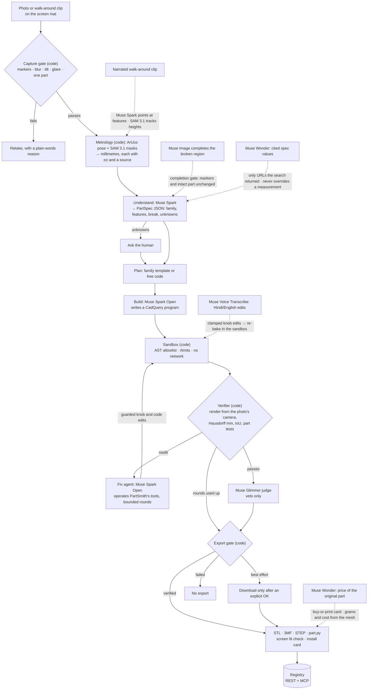
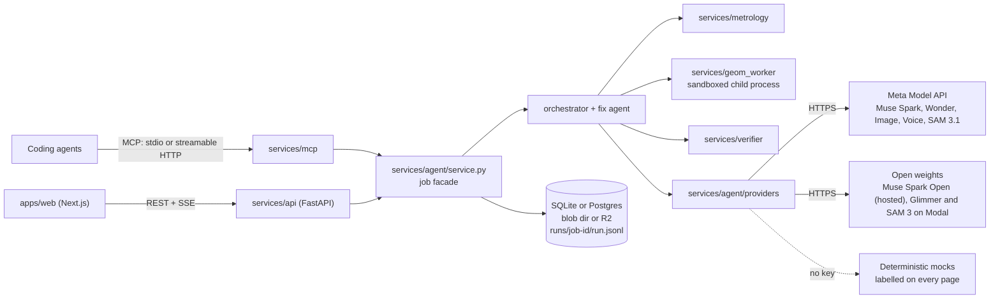

# Architecture

PartSmith turns phone photos of a broken plastic part on a calibration mat into a measured, verified, parametric CadQuery
program. The model proposes; deterministic code decides. Units are millimetres everywhere.

## Pipeline

One job, as `services/agent/orchestrator.py` runs it (stages: capture → measure → understand → ask → plan → build → execute →
verify → fix → judge → package → learn). Solid arrows are the main path; dotted arrows are side paths whose output code
accepts only after a check. Boxes that name a model are model calls through `services/agent/providers`; boxes marked
"(code)" are deterministic checks.



| Side path | Model | The check that decides | Code |
|---|---|---|---|
| Narrated walk-around clip | Muse Spark points at the features it hears about; SAM 3.1 tracks the part across frames | a point is kept only if it lands on the part in its own frame and on the measured footprint; heights come from the tracked frames | `services/metrology/narration.py`, `services/metrology/points.py`, `services/agent/evidence.py` |
| Broken-region completion | Muse Image | every mat marker re-detects in place and the intact part is unchanged; accepted completions enter as inferred | `services/metrology/recon_gate.py`, `services/agent/evidence.py` |
| Cited specs | Muse Wonder (web search) | a value is accepted only if a search ran and its URL came back from it; it fills unknowns and never overrides a measurement | `services/agent/providers/spec.py` |
| Buy or print | Muse Wonder (search grounding) | a price is kept only with its source link and a quote showing it; grams, print time and cost come from the mesh | `services/agent/providers/buy.py`, `services/agent/buy_or_print.py` |
| Judge | Muse Glimmer 30B | veto only: it can block a pass, never grant one | `services/agent/orchestrator.py` |
| Voice edits | Muse Voice Transcribe | knob names and ranges clamp every edit; the edited part is re-baked in the sandbox and labelled "not re-verified" | `services/media/voice.py`, `services/agent/service.py` |

## Runtime



## Modules

```
 apps/web (Next.js) ── REST + SSE ──▶ services/api (FastAPI) ◀── services/mcp (MCP, stdio + streamable HTTP)
                                         │
        ┌────────────────┬───────────────┼──────────────────┬───────────────────┬──────────────┐
  services/metrology  services/agent  services/geom_worker  services/verifier  services/media
  mat, calibration,   orchestrator,   sandboxed CadQuery    silhouettes,       preview, repair
  capture gate, SAM,  providers,      exec, exporters,      IoU / Hausdorff,   card, coupon,
  contours → mm,      templates,      bake cache            feature residuals, template PDF
  features, fit check prompts, jobs                         part tests
                                         │
                       storage: SQLite (default) or Postgres · local blob dir (default) or R2
```

## Python layout

One CPU environment (root `pyproject.toml`, Python 3.12, managed by `uv`) holds the API, the agent and the geometry code.
Isolation that matters for safety comes from **processes**: LLM-written CadQuery only runs in a child process started by
`services/geom_worker/sandbox.py` (AST allowlist, rlimits, no network, temp dir). SAM 3 open weights need `numpy<2` and a
GPU, so they live in their own Modal image (`infra/modal/sam3.py`) and are reached over HTTP. See `docs/DECISIONS.md`.

Import roots: the repo root (`services`, `eval`, `tools`) and `packages/schemas` (`partsmith_schemas`).

Runtime data lives in `$PARTSMITH_HOME` (default `./var`, gitignored): `blobs/` (content-addressed by sha256), `runs/<job>/run.jsonl`,
`partsmith.db` (SQLite), `bakes/`.

## Contracts (`packages/schemas/partsmith_schemas`)

| Module | Types |
|---|---|
| `common` | `Source` (measured / user_stated / inferred), `DataOrigin` (real / synthetic / reference_object / replay), `GroundTruthSource`, `Measured`, pass thresholds |
| `measurement` | `CaptureReport`, `Calibration`, `CameraPose`, `Measurements`, `Hole`, `Slot`, `MeasureResult` |
| `partspec` | `PartSpec` with a discriminated `Feature` union |
| `verification` | `ParamSpec`, `ViewMetrics`, `FeatureResidual`, `PartTest`, `Validity`, `JudgeVeto`, `Verification` |
| `events` | `StageEvent`, `MetricEvent`, `ArtifactEvent`, `QuestionEvent`, `AnswerEvent`, `ModelCallEvent`, `IterationEvent`, `LogEvent`, `DoneEvent` |
| `registry` | `JobInput`, `JobSummary`, `PartRecord`, `PartFacts`, `BakeResult`, `VariantResult`, `Need` |

`python -m partsmith_schemas.export` writes JSON Schema to `packages/schemas/json/` and TypeScript to `apps/web/src/lib/schemas.ts`.

## Frames

- **Mat frame:** x right, y down, z into the table, origin at the mat's top-left marker-layout origin, mm.
- **Part frame:** centre of the measured min-area rectangle, long side +X, Y up, Z up out of the mat, mounting face on Z = 0.
- **CAD frame:** identical to the part frame. Placement on the mat: `T = translate(cx, cy) · Rz(θ) · diag(1, -1, -1)`.

## Module interfaces

### `services/metrology`
- `mats.py` — `MatSpec` registry. Screen mats (`screen-s`, `screen-m`, `screen-l`) and the paper mat (`paper-a4`) are rings of
  ArUco markers (`DICT_5X5_100`) around a plain "stage" where the part sits. Each mat uses a disjoint id range, so detection
  identifies the mat from the ids it sees. `MatSpec.layout_json()` is what the web screen-mat page draws (marker bits included).
- `calibrate.py` — `detect_mat(img) -> MatDetection`, `homography`, `estimate_pose(det, K)`, `rectify(img, H, px_per_mm)`,
  `height_scale(camera_height_mm, h_mm)`.
- `capture_gate.py` — `run_gate(img, det, mask=None) -> CaptureReport` (markers, reprojection, blur, coverage, tilt, exposure, glare, moiré).
- `segment.py` — `Segmenter` protocol; `ProviderSegmenter` (SAM 3.1 via providers, prompt ladder, crop re-run), `ThresholdSegmenter`
  (deterministic, uses the plain stage background), mask post-processing.
- `features.py` — contour → mm, circle fit (algebraic + geometric refinement), slot fit, symmetry axis, uncertainty.
- `measure.py` — `measure_photo(image, view, *, mat_kind, segmenter, thickness_mm=None) -> MeasureResult` + overlay images.
- `card.py` — ID-1 card scale calibration maths (85.60 × 53.98 mm).
- `fit_check.py` — screen fit check: photo of the real part lying on the model's 1:1 outline → pass/fail + overlay.

### `services/geom_worker`
- `sandbox.py` — `check_code(code) -> list[Violation]`, `run_program(code, params, *, timeout_s, mem_mb) -> ExecResult`.
- `program.py` — `parse_params(code) -> list[ParamSpec]`, `defaults(code)`, `clamp(params, specs)`.
- `export.py` — STL, STEP, 3MF, GLB and `view.json` (triangles + B-rep edge polylines for the web viewer).
- `bake.py` — `bake(code, params, formats) -> BakeResult`, cache key = sha256(code_sha, version, sorted params).

### `services/verifier`
- `render.py` — orthographic top / side silhouettes in the rectified frame; camera-pose silhouettes.
- `metrics.py` — `iou`, `contour_distances_mm` (Hausdorff, HD95, mean), over/under areas, residual heatmap overlay.
- `solid_features.py` — measure the model: cylindrical faces → hole Ø and centre, bbox, thickness.
- `part_tests.py` — tests generated from `PartSpec` (`hole_1 Ø == 4.20 ± 0.15`, `bbox.x == 40.0 ± 0.3`, …).
- `verify.py` — `verify(exec_result, measurements, partspec, vetoes=[]) -> (Verification, overlays)`. Sole authority for `verified`.

### `services/agent`
- `providers/` — every model call: `complete(stage, req)`, `segment`, `generate_image`, `transcribe`, `status()`,
  `job_context(job_id, emit)`, `register_mock(stage, handler)`; `PROVIDER_MODE=live|mock|replay`, auto-mock on a missing key (logged
  and shown on `/status`), `model_call` events with tokens, ms and $.
- `templates/` — 10 family templates (`PARAMS` + `build(p)`), each with a topology knob.
- `prompts/` — versioned prompt files.
- `orchestrator.py` — capture → measure → understand → ask → plan → build → execute → verify → fix (≤ 6) → judge → package → learn.
- `jobs.py` — job state machine, pause/resume on questions, event bus, `run.jsonl`, replay.

### `services/api`, `services/mcp`, `services/media`, `services/cli.py`
REST under `/api/v1` (PLAN §8.3) with OpenAPI at `/api/v1/openapi.json`; SSE at `/api/v1/jobs/{id}/events`.
MCP tools: `search_parts`, `get_part`, `get_variant`, `bake`, `find_matching`, `list_families`, `measure_photo`, `start_fix_job`,
`get_job`, `report_need`. CLI: `partsmith fix <folder>`, `partsmith bake`, `partsmith synth`, `partsmith mat`, `partsmith serve`.

### `tools/`, `eval/`
`tools/mat` (paper mat + template PDFs), `tools/calib` (camera intrinsics), `tools/synth` (synthetic photos + reference objects,
exact ground truth), `tools/smoke.py` (`make smoke`). `eval/` runs the synthetic, reference-objects and real-ruler benches and
writes `eval/reports/<date>/` plus `eval/reports/latest`.
