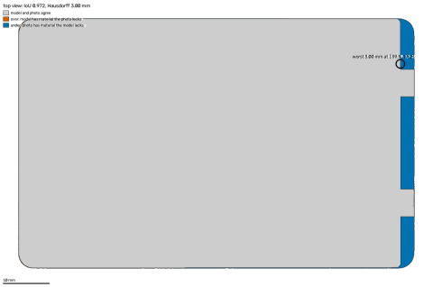
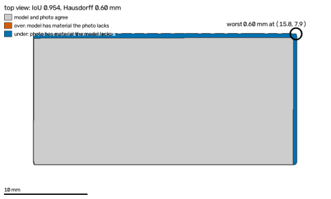
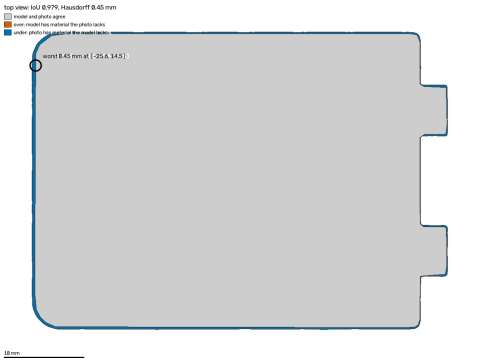
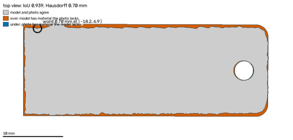

# PartSmith-Bench — 2026-10-27T11:43:17+00:00

> **PIPELINE CHECK — DETERMINISTIC MOCK PROVIDERS, NOT MODEL PERFORMANCE.** Every model stage ran on deterministic mocks; these tables show that the pipeline and the scorer work end to end, not how well any model performs.

Mode: `mock` · git `3237b2faba` · CI: 95 %: bootstrap over samples (2000 resamples, seeded) for mean errors; Wilson for rates.
- tables rebuilt from 70 stored run(s) in eval/runs/mock/ (nothing re-run)

## pipeline check — deterministic mock providers, NOT model performance · synthetic (GT: exact: the template mesh the photo was rendered from)

Ground truth: `synthetic_exact` · N = 6 samples · headline = PS on the held-out split (6 samples); MOCK providers: these numbers check the pipeline, they do not measure any model

| config | n | median_abs_err_mm | mean_abs_err_mm | mean_ci95 | pass@0.5 | pass@0.5_ci95 | verified_rate | valid_rate | median_iters | median_wall_s | usd_per_job | tokens_per_job |
|---|---|---|---|---|---|---|---|---|---|---|---|---|
| B0 | 6 | 0.725 | 3.765 | [1.063, 7.300] | 0.167 | [0.03, 0.56] | 0.0 | 0.833 | 1.0 | 11.3 | 0.0 | 0.0 |
| B1 | 6 | 0.3 | 2.43 | [0.214, 6.477] | 0.5 | [0.19, 0.81] | 0.0 | 0.833 | 1.0 | 13.7 | 0.0 | 0.0 |
| B2 | 6 | 0.164 | 5.306 | [0.946, 11.954] | 0.167 | [0.03, 0.56] | 0.0 | 0.833 | 6.0 | 18.9 | 0.0 | 0.0 |
| PS | 6 | 0.1 | 3.638 | [0.314, 10.946] | 0.167 | [0.03, 0.56] | 0.167 | 0.833 | 6.0 | 31.4 | 0.0 | 0.0 |
| PS-noTemplate | 6 | 0.164 | 5.306 | [0.946, 11.954] | 0.167 | [0.03, 0.56] | 0.0 | 0.833 | 3.0 | 15.2 | 0.0 | 0.0 |
| PS-noJudge | 6 | 0.1 | 3.638 | [0.314, 10.946] | 0.167 | [0.03, 0.56] | 0.167 | 0.833 | 6.0 | 28.4 | 0.0 | 0.0 |
| PS-noHeightCorr | 6 | 0.9 | 3.864 | [0.639, 10.936] | 0.167 | [0.03, 0.56] | 0.0 | 0.833 | 6.0 | 23.3 | 0.0 | 0.0 |

Paired exact McNemar, B1 vs PS on pass@0.5 (6 pairs): B1-only passes 2, PS-only passes 0, p = 0.5.

## pipeline check — deterministic mock providers, NOT model performance · reference objects (GT: published spec (AA cell: loose spec))

Ground truth: `reference_spec` · N = 4 samples · headline = PS on the held-out split (4 samples); MOCK providers: these numbers check the pipeline, they do not measure any model

| config | n | median_abs_err_mm | mean_abs_err_mm | mean_ci95 | pass@0.5 | pass@0.5_ci95 | verified_rate | valid_rate | median_iters | median_wall_s | usd_per_job | tokens_per_job |
|---|---|---|---|---|---|---|---|---|---|---|---|---|
| B0 | 4 | 3.74 | 4.411 | [3.367, 5.730] | 0.0 | [0.00, 0.49] | 0.0 | 1.0 | 1.0 | 8.8 | 0.0 | 0.0 |
| B1 | 4 | 0.4 | 1.342 | [1.080, 1.600] | 0.0 | [0.00, 0.49] | 0.0 | 1.0 | 1.0 | 10.8 | 0.0 | 0.0 |
| B2 | 4 | 0.09 | 0.634 | [0.177, 1.188] | 0.25 | [0.05, 0.70] | 0.5 | 1.0 | 5.0 | 16.1 | 0.0 | 0.0 |
| PS | 4 | 0.09 | 0.634 | [0.177, 1.188] | 0.25 | [0.05, 0.70] | 0.5 | 1.0 | 5.0 | 20.4 | 0.0 | 0.0 |
| PS-noTemplate | 4 | 0.066 | 0.352 | [0.040, 0.591] | 0.25 | [0.05, 0.70] | 0.5 | 0.75 | 1.0 | 10.9 | 0.0 | 0.0 |
| PS-noJudge | 4 | 0.09 | 0.634 | [0.177, 1.188] | 0.25 | [0.05, 0.70] | 0.5 | 1.0 | 5.0 | 17.5 | 0.0 | 0.0 |
| PS-noHeightCorr | 4 | 0.7 | 1.297 | [1.052, 1.504] | 0.0 | [0.00, 0.49] | 0.25 | 1.0 | 6.0 | 10.4 | 0.0 | 0.0 |

Paired exact McNemar, B1 vs PS on pass@0.5 (4 pairs): B1-only passes 0, PS-only passes 1, p = 1.

## pipeline check — deterministic mock providers, NOT model performance · real ruler (GT: school ruler, ±0.5 mm (never caliper accuracy))

Ground truth: `ruler` · N = 0 samples · pending: no real parts with ruler ground truth yet (data/real/<part>/gt.yaml, see eval/REPRODUCE.md)

**pending**

## Failure gallery (PS)

- **ref-aa-cell-clean-s23585 · PS (reference_objects, held_out)** — worst length -0.65 mm 
- **ref-id1-card-clean-s787514 · PS (reference_objects, held_out)** — worst thickness +3.74 mm 
- **ref-lego-2x4-clean-s496628 · PS (reference_objects, held_out)** — worst thickness -1.70 mm 
- **syn-battery-cover-glare-s261884 · PS (synthetic, held_out)** — worst thickness -3.65 mm 
- **syn-clip-white-part-s468432 · PS (synthetic, held_out)** — worst width +0.80 mm 
- **syn-hinge-leaf-white-part-s529109 · PS (synthetic, held_out)** — worst length -36.34 mm; missing hole_1.diameter, hole_2.diameter 
- **syn-hook-glare-s235877 · PS (synthetic, held_out)** — worst thickness +2.95 mm 
- **syn-l-bracket-moire-s114398 · PS (synthetic, held_out)** — job failed: Wavy stripes from the screen are visible — move the phone a little further away or rotate it slightly.

## Measurement only (Phase 1 bench)

From `eval/reports/2026-10-27/measure_only.json`: synthetic mean 1.348 mm, reference objects mean 0.346 mm → gate FAIL.
