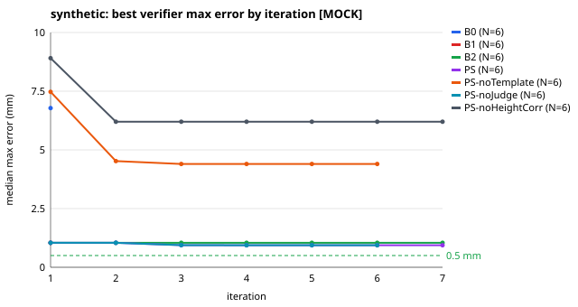
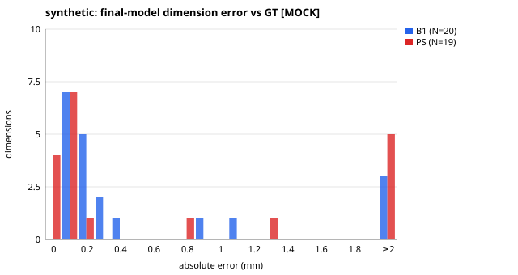
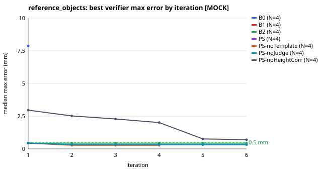
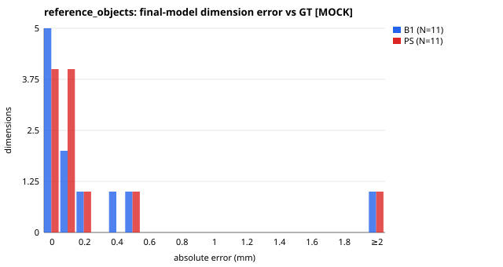
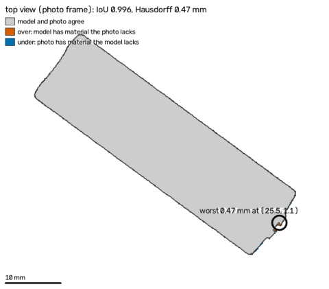
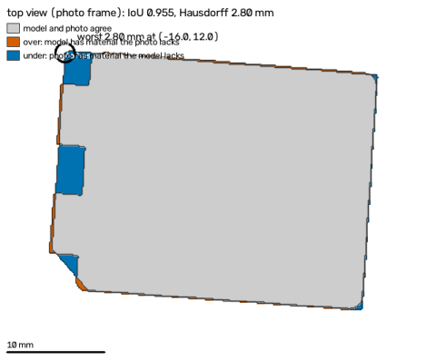
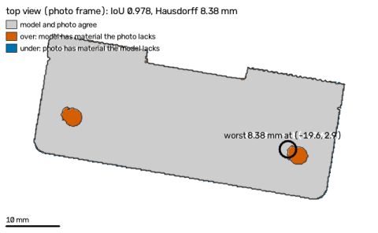
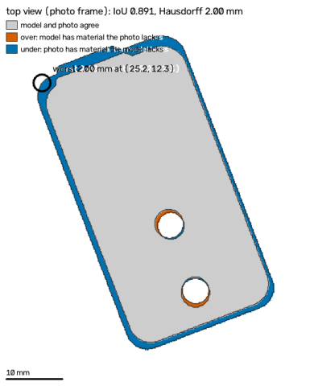

# PartSmith-Bench — 2026-10-27T13:57:10+00:00

> **PIPELINE CHECK — DETERMINISTIC MOCK PROVIDERS, NOT MODEL PERFORMANCE.** Every model stage ran on deterministic mocks; these tables show that the pipeline and the scorer work end to end, not how well any model performs.

Mode: `mock` · git `1d815f4f2a` · CI: 95 %: bootstrap over samples (2000 resamples, seeded) for mean errors; Wilson for rates.
- tables rebuilt from 70 stored run(s) in eval/runs/mock/ (nothing re-run)

## pipeline check — deterministic mock providers, NOT model performance · synthetic (GT: exact: the template mesh the photo was rendered from)

Ground truth: `synthetic_exact` · N = 6 samples · headline = PS on the held-out split (6 samples); MOCK providers: these numbers check the pipeline, they do not measure any model

| config | n | median_abs_err_mm | mean_abs_err_mm | mean_ci95 | pass@0.5 | pass@0.5_ci95 | verified_rate | valid_rate | median_iters | median_wall_s | usd_per_job | tokens_per_job |
|---|---|---|---|---|---|---|---|---|---|---|---|---|
| B0 | 6 | 0.6 | 2.34 | [1.089, 3.539] | 0.167 | [0.03, 0.56] | 0.0 | 0.833 | 1.0 | 12.3 | 0.0 | 0.0 |
| B1 | 6 | 0.3 | 0.45 | [0.203, 0.730] | 0.5 | [0.19, 0.81] | 0.167 | 0.833 | 1.0 | 12.2 | 0.0 | 0.0 |
| B2 | 6 | 0.15 | 0.514 | [0.165, 0.851] | 0.5 | [0.19, 0.81] | 0.333 | 0.833 | 5.0 | 12.5 | 0.0 | 0.0 |
| PS | 6 | 0.15 | 0.482 | [0.147, 0.844] | 0.5 | [0.19, 0.81] | 0.333 | 0.833 | 4.0 | 17.6 | 0.0 | 0.0 |
| PS-noTemplate | 6 | 0.131 | 2.337 | [0.685, 4.379] | 0.167 | [0.03, 0.56] | 0.167 | 0.833 | 3.0 | 16.0 | 0.0 | 0.0 |
| PS-noJudge | 6 | 0.15 | 0.466 | [0.147, 0.793] | 0.5 | [0.19, 0.81] | 0.333 | 0.833 | 4.0 | 17.6 | 0.0 | 0.0 |
| PS-noHeightCorr | 6 | 0.3 | 0.52 | [0.239, 0.900] | 0.167 | [0.03, 0.56] | 0.0 | 0.833 | 6.0 | 19.1 | 0.0 | 0.0 |

Paired exact McNemar, B1 vs PS on pass@0.5 (6 pairs): B1-only passes 0, PS-only passes 0, p = 1.

## pipeline check — deterministic mock providers, NOT model performance · reference objects (GT: published spec (AA cell: loose spec))

Ground truth: `reference_spec` · N = 4 samples · headline = PS on the held-out split (4 samples); MOCK providers: these numbers check the pipeline, they do not measure any model

| config | n | median_abs_err_mm | mean_abs_err_mm | mean_ci95 | pass@0.5 | pass@0.5_ci95 | verified_rate | valid_rate | median_iters | median_wall_s | usd_per_job | tokens_per_job |
|---|---|---|---|---|---|---|---|---|---|---|---|---|
| B0 | 4 | 3.4 | 4.584 | [3.589, 5.330] | 0.0 | [0.00, 0.49] | 0.0 | 1.0 | 1.0 | 9.2 | 0.0 | 0.0 |
| B1 | 4 | 0.131 | 0.453 | [0.125, 0.890] | 0.5 | [0.15, 0.85] | 0.25 | 1.0 | 1.0 | 9.0 | 0.0 | 0.0 |
| B2 | 4 | 0.075 | 0.153 | [0.063, 0.307] | 0.75 | [0.30, 0.95] | 0.25 | 1.0 | 3.0 | 9.2 | 0.0 | 0.0 |
| PS | 4 | 0.1 | 0.439 | [0.066, 0.923] | 0.5 | [0.15, 0.85] | 0.5 | 1.0 | 2.5 | 10.4 | 0.0 | 0.0 |
| PS-noTemplate | 4 | 0.131 | 0.175 | [0.066, 0.307] | 0.75 | [0.30, 0.95] | 0.5 | 1.0 | 2.5 | 10.7 | 0.0 | 0.0 |
| PS-noJudge | 4 | 0.1 | 0.439 | [0.066, 0.923] | 0.5 | [0.15, 0.85] | 0.5 | 1.0 | 2.5 | 10.5 | 0.0 | 0.0 |
| PS-noHeightCorr | 4 | 0.353 | 0.685 | [0.264, 1.284] | 0.25 | [0.05, 0.70] | 0.0 | 1.0 | 4.5 | 10.8 | 0.0 | 0.0 |

Paired exact McNemar, B1 vs PS on pass@0.5 (4 pairs): B1-only passes 0, PS-only passes 0, p = 1.

## pipeline check — deterministic mock providers, NOT model performance · real ruler (GT: school ruler, ±0.5 mm (never caliper accuracy))

Ground truth: `ruler` · N = 0 samples · no real parts with ruler ground truth yet (data/real/<part>/gt.yaml, see eval/REPRODUCE.md)

**pending**

## Failure gallery (PS)

- **ref-aa-cell-clean-s23585 · PS (reference_objects, held_out)** — worst length -0.56 mm 
- **ref-sd-card-clean-s596360 · PS (reference_objects, held_out)** — worst thickness +3.40 mm 
- **syn-hinge-leaf-white-part-s529109 · PS (synthetic, held_out)** — worst thickness -3.01 mm; missing hole_1.diameter, hole_2.diameter 
- **syn-hook-glare-s235877 · PS (synthetic, held_out)** — worst length -1.70 mm 
- **syn-l-bracket-moire-s114398 · PS (synthetic, held_out)** — job failed: Wavy stripes from the screen are visible — move the phone a little further away or rotate it slightly.

## Measurement only (Phase 1 bench)

From `eval/reports/2026-10-27/measure_only.json`: synthetic mean 0.466 mm, reference objects mean 0.170 mm → gate FAIL.
