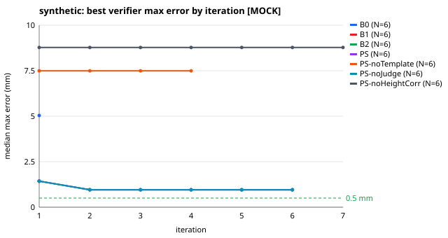
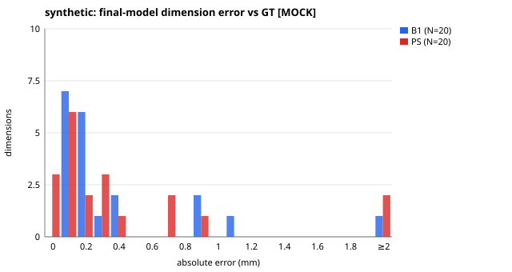
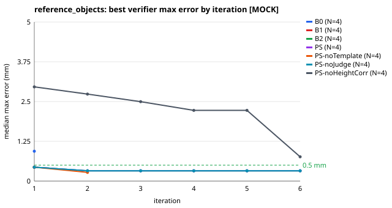
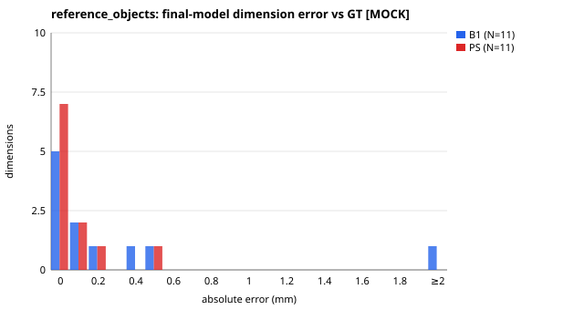
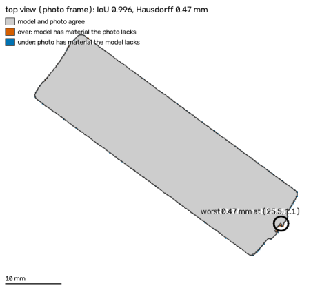
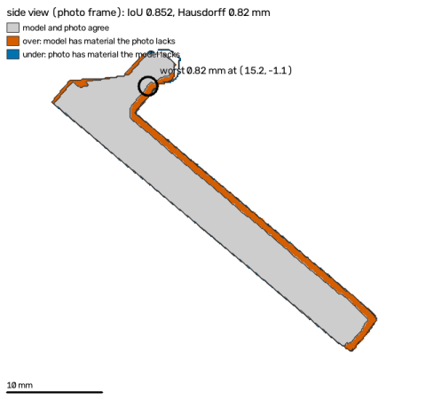
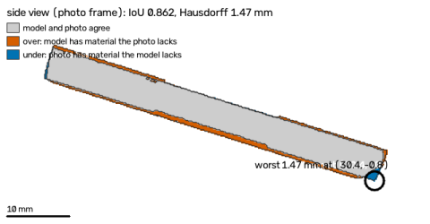
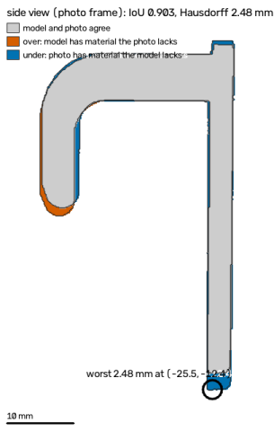

# PartSmith-Bench — 2026-10-28T16:03:49+00:00

> **PIPELINE CHECK — DETERMINISTIC MOCK PROVIDERS, NOT MODEL PERFORMANCE.** Every model stage ran on deterministic mocks; these tables show that the pipeline and the scorer work end to end, not how well any model performs.

Mode: `mock` · git `1c91d0f00c` · CI: 95 %: bootstrap over samples (2000 resamples, seeded) for mean errors; Wilson for rates.
- PS-open / PS-open-all are provider-routing variants: identical to PS with mock providers, so they run only with --live
- synthetic: seeded subset of 6/60 bench samples (seed 7)
- reference_objects: 4 synthetic renders; real photos pending (data/real/reference_objects/)
- real_ruler: no real parts with ruler ground truth yet (data/real/<part>/gt.yaml)
- control: 6 synthetic photos with expected outcomes, run with PS only
- redteam: 10 synthetic photos with expected outcomes, run with PS only

## pipeline check — deterministic mock providers, NOT model performance · synthetic (GT: exact: the template mesh the photo was rendered from)

Ground truth: `synthetic_exact` · N = 6 samples · synthetic: seeded subset of 6/60 bench samples (seed 7); headline = PS on the held-out split (6 samples); MOCK providers: these numbers check the pipeline, they do not measure any model

| config | n | median_abs_err_mm | mean_abs_err_mm | mean_ci95 | pass@0.5 | pass@0.5_ci95 | verified_rate | verified_but_off | valid_rate | median_iters | median_wall_s | usd_per_job | tokens_per_job |
|---|---|---|---|---|---|---|---|---|---|---|---|---|---|
| B0 | 6 | 1.05 | 2.43 | [1.132, 3.602] | 0.167 | [0.03, 0.56] | 0.0 | 0/0 | 0.833 | 1.0 | 10.1 | 0.0 | 0.0 |
| B1 | 6 | 0.3 | 0.49 | [0.247, 0.739] | 0.333 | [0.10, 0.70] | 0.167 | 0/1 | 0.833 | 1.0 | 10.2 | 0.0 | 0.0 |
| B2 | 6 | 0.3 | 0.515 | [0.150, 0.986] | 0.333 | [0.10, 0.70] | 0.333 | 0/2 | 0.833 | 2.0 | 27.7 | 0.0 | 0.0 |
| PS | 6 | 0.3 | 0.515 | [0.150, 0.986] | 0.333 | [0.10, 0.70] | 0.333 | 0/2 | 0.833 | 2.0 | 26.8 | 0.0 | 0.0 |
| PS-noTemplate | 6 | 0.14 | 2.319 | [0.685, 4.351] | 0.167 | [0.03, 0.56] | 0.167 | 0/1 | 0.833 | 1.0 | 12.7 | 0.0 | 0.0 |
| PS-noJudge | 6 | 0.3 | 0.515 | [0.150, 0.986] | 0.333 | [0.10, 0.70] | 0.333 | 0/2 | 0.833 | 2.0 | 27.2 | 0.0 | 0.0 |
| PS-noHeightCorr | 6 | 0.4 | 0.605 | [0.333, 0.941] | 0.167 | [0.03, 0.56] | 0.0 | 0/0 | 0.833 | 4.0 | 37.2 | 0.0 | 0.0 |

Paired exact McNemar, B1 vs PS on pass@0.5 (6 pairs): B1-only passes 0, PS-only passes 0, p = 1.

## pipeline check — deterministic mock providers, NOT model performance · reference objects (GT: published spec (AA cell: loose spec))

Ground truth: `reference_spec` · N = 4 samples · reference_objects: 4 synthetic renders; real photos pending (data/real/reference_objects/); headline = PS on the held-out split (4 samples); MOCK providers: these numbers check the pipeline, they do not measure any model

| config | n | median_abs_err_mm | mean_abs_err_mm | mean_ci95 | pass@0.5 | pass@0.5_ci95 | verified_rate | verified_but_off | valid_rate | median_iters | median_wall_s | usd_per_job | tokens_per_job |
|---|---|---|---|---|---|---|---|---|---|---|---|---|---|
| B0 | 4 | 0.268 | 1.116 | [0.216, 2.498] | 0.25 | [0.05, 0.70] | 0.0 | 0/0 | 1.0 | 1.0 | 7.8 | 0.0 | 0.0 |
| B1 | 4 | 0.131 | 0.453 | [0.125, 0.890] | 0.5 | [0.15, 0.85] | 0.0 | 0/0 | 1.0 | 1.0 | 8.2 | 0.0 | 0.0 |
| B2 | 4 | 0.05 | 0.121 | [0.039, 0.290] | 0.75 | [0.30, 0.95] | 0.25 | 0/1 | 1.0 | 1.5 | 10.5 | 0.0 | 0.0 |
| PS | 4 | 0.05 | 0.121 | [0.039, 0.290] | 0.75 | [0.30, 0.95] | 0.25 | 0/1 | 1.0 | 1.5 | 10.6 | 0.0 | 0.0 |
| PS-noTemplate | 4 | 0.131 | 0.175 | [0.066, 0.307] | 0.75 | [0.30, 0.95] | 0.25 | 0/1 | 1.0 | 1.5 | 10.3 | 0.0 | 0.0 |
| PS-noJudge | 4 | 0.05 | 0.121 | [0.039, 0.290] | 0.75 | [0.30, 0.95] | 0.25 | 0/1 | 1.0 | 1.5 | 10.4 | 0.0 | 0.0 |
| PS-noHeightCorr | 4 | 0.259 | 0.527 | [0.241, 0.890] | 0.25 | [0.05, 0.70] | 0.0 | 0/0 | 1.0 | 3.5 | 15.1 | 0.0 | 0.0 |

Paired exact McNemar, B1 vs PS on pass@0.5 (4 pairs): B1-only passes 0, PS-only passes 1, p = 1.

## pipeline check — deterministic mock providers, NOT model performance · real ruler (GT: school ruler, ±0.5 mm (never caliper accuracy))

Ground truth: `ruler` · N = 0 samples · real_ruler: no real parts with ruler ground truth yet (data/real/<part>/gt.yaml)

**pending**

## pipeline check — deterministic mock providers, NOT model performance · control (intact parts, normal photos → accept)

Ground truth: `expected_outcome` · N = 6 samples · 6/6 handled as expected ([0.61, 1.00]); config PS

| case | expected | expected_checks | outcome | failed_checks | correct |
|---|---|---|---|---|---|
| ctl-cable-clip-s447475 | accept | any | accept | – | True |
| ctl-clip-s55909 | accept | any | accept | – | True |
| ctl-cupboard-latch-s844149 | accept | any | accept | – | True |
| ctl-hook-s21548 | accept | any | accept | – | True |
| ctl-knob-s936521 | accept | any | accept | – | True |
| ctl-spacer-s435219 | accept | any | accept | – | True |

## pipeline check — deterministic mock providers, NOT model performance · redteam (photos that must be rejected or refused)

Ground truth: `expected_outcome` · N = 10 samples · 10/10 handled as expected ([0.72, 1.00]); config PS

| case | expected | expected_checks | outcome | failed_checks | correct |
|---|---|---|---|---|---|
| rt-flexible-object | refuse | any | refuse | – | True |
| rt-hand-in-frame | reject | coverage,contrast | reject | coverage,contrast | True |
| rt-no-part | reject | coverage | reject | coverage | True |
| rt-organic-object | refuse | any | refuse | – | True |
| rt-part-off-stage | reject | coverage | reject | coverage | True |
| rt-partial-mat | reject | markers,coverage,reprojection | reject | coverage | True |
| rt-photo-of-screen | reject | moire,blur,contrast | reject | moire | True |
| rt-safety-part | refuse | any | refuse | – | True |
| rt-two-parts | reject | any | reject | single_part | True |
| rt-wrong-mat | reject | markers | reject | markers,reprojection,blur,tilt,scale | True |

## Failure taxonomy (one category per failed run)

| suite | config | runs | seg_fail | scale_fail | capture_reject | codegen_error | topology_wrong | dim_off | timeout | refused | judge_veto |
|---|---|---|---|---|---|---|---|---|---|---|---|
| control | PS | 6 | 0 | 0 | 0 | 0 | 1 | 0 | 0 | 0 | 0 |
| synthetic | PS | 6 | 0 | 0 | 1 | 0 | 1 | 2 | 0 | 0 | 0 |
| synthetic | B0 | 6 | 0 | 0 | 1 | 0 | 1 | 3 | 0 | 0 | 0 |
| synthetic | B1 | 6 | 0 | 0 | 1 | 0 | 1 | 2 | 0 | 0 | 0 |
| synthetic | B2 | 6 | 0 | 0 | 1 | 0 | 1 | 2 | 0 | 0 | 0 |
| synthetic | PS-noTemplate | 6 | 0 | 0 | 1 | 0 | 1 | 3 | 0 | 0 | 0 |
| synthetic | PS-noJudge | 6 | 0 | 0 | 1 | 0 | 1 | 2 | 0 | 0 | 0 |
| synthetic | PS-noHeightCorr | 6 | 0 | 0 | 1 | 0 | 1 | 3 | 0 | 0 | 0 |
| reference_objects | PS | 4 | 0 | 0 | 0 | 0 | 0 | 1 | 0 | 0 | 0 |
| reference_objects | B0 | 4 | 0 | 0 | 0 | 0 | 0 | 3 | 0 | 0 | 0 |
| reference_objects | B1 | 4 | 0 | 0 | 0 | 0 | 0 | 2 | 0 | 0 | 0 |
| reference_objects | B2 | 4 | 0 | 0 | 0 | 0 | 0 | 1 | 0 | 0 | 0 |
| reference_objects | PS-noTemplate | 4 | 0 | 0 | 0 | 0 | 0 | 1 | 0 | 0 | 0 |
| reference_objects | PS-noJudge | 4 | 0 | 0 | 0 | 0 | 0 | 1 | 0 | 0 | 0 |
| reference_objects | PS-noHeightCorr | 4 | 0 | 0 | 0 | 0 | 0 | 3 | 0 | 0 | 0 |

## Failure gallery (PS)

- **ref-aa-cell-clean-s23585 · PS (reference_objects, held_out)** — worst length -0.56 mm 
- **syn-clip-white-part-s468432 · PS (synthetic, held_out)** — worst thickness -0.90 mm 
- **syn-hinge-leaf-white-part-s529109 · PS (synthetic, held_out)** — worst hole_1.diameter +0.35 mm; missing hole_2.diameter 
- **syn-hook-glare-s235877 · PS (synthetic, held_out)** — worst length -2.80 mm 
- **syn-l-bracket-moire-s114398 · PS (synthetic, held_out)** — job failed: Wavy stripes from the screen are visible — move the phone a little further away or rotate it slightly.

## Measurement only (Phase 1 bench)

From `eval/reports/2026-10-28/measure_only.json`: synthetic mean 0.468 mm, reference objects mean 0.178 mm → gate FAIL.
