# PartSmith-Bench — 2026-10-29T20:43:37+00:00

Mode: `live` · git `304f9333bc` · CI: 95 %: bootstrap over samples (2000 resamples, seeded) for mean errors; Wilson for rates.
- tables rebuilt from 76 stored run(s) in eval/runs/live/ (nothing re-run)

## synthetic (GT: exact: the template mesh the photo was rendered from)

Ground truth: `synthetic_exact` · N = 12 samples · headline = PS on the held-out split (12 samples)

| config | n | median_abs_err_mm | mean_abs_err_mm | mean_ci95 | pass@0.5 | pass@0.5_ci95 | verified_rate | verified_but_off | valid_rate | median_iters | median_wall_s | usd_per_job | tokens_per_job |
|---|---|---|---|---|---|---|---|---|---|---|---|---|---|
| B1 | 12 | 0.18 | 0.856 | [0.313, 1.674] | 0.083 | [0.01, 0.35] | 0.083 | 0/1 | 0.833 | 1.0 | 142.1 | 0.0681 | 24150.0 |
| PS | 12 | 0.1 | 0.604 | [0.221, 1.196] | 0.25 | [0.09, 0.53] | 0.167 | 0/2 | 0.833 | 6.0 | 363.3 | 0.2091 | 216600.0 |
| PS-noTemplate | 12 | 0.23 | 0.914 | [0.481, 1.574] | 0.083 | [0.01, 0.35] | 0.167 | 1/2 | 0.833 | 4.5 | 355.4 | 0.213 | 238577.0 |

Paired exact McNemar, B1 vs PS on pass@0.5 (12 pairs): B1-only passes 0, PS-only passes 2, p = 0.5.

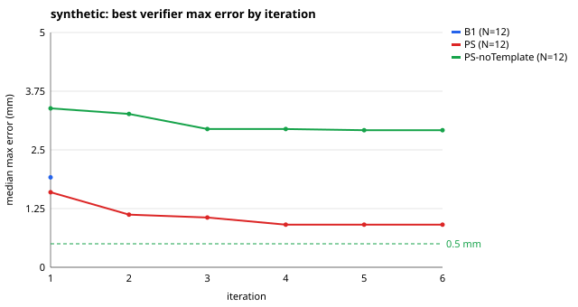

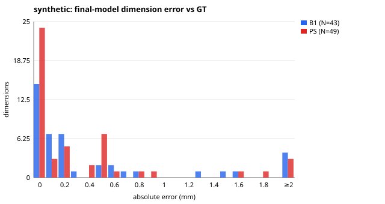

## reference objects (GT: published spec (AA cell: loose spec))

Ground truth: `reference_spec` · N = 8 samples · headline = PS on the held-out split (8 samples)

| config | n | median_abs_err_mm | mean_abs_err_mm | mean_ci95 | pass@0.5 | pass@0.5_ci95 | verified_rate | verified_but_off | valid_rate | median_iters | median_wall_s | usd_per_job | tokens_per_job |
|---|---|---|---|---|---|---|---|---|---|---|---|---|---|
| B1 | 8 | 0.04 | 0.142 | [0.027, 0.330] | 0.75 | [0.41, 0.93] | 0.25 | 0/2 | 1.0 | 1.0 | 73.1 | 0.0492 | 21706.0 |
| PS | 8 | 0.05 | 0.155 | [0.052, 0.303] | 0.75 | [0.41, 0.93] | 0.5 | 0/4 | 1.0 | 2.5 | 123.2 | 0.1631 | 157113.0 |
| PS-noTemplate | 8 | 0.066 | 0.159 | [0.049, 0.336] | 0.75 | [0.41, 0.93] | 0.5 | 0/4 | 1.0 | 2.5 | 181.8 | 0.2073 | 219762.0 |

Paired exact McNemar, B1 vs PS on pass@0.5 (8 pairs): B1-only passes 0, PS-only passes 0, p = 1.

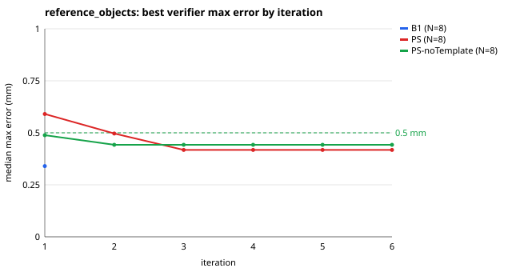

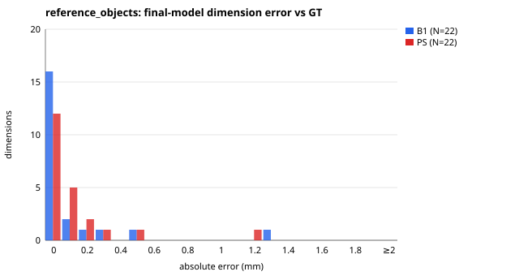

## real ruler (GT: school ruler, ±0.5 mm (never caliper accuracy))

Ground truth: `ruler` · N = 0 samples · no real parts with ruler ground truth yet (data/real/<part>/gt.yaml, see eval/REPRODUCE.md)

**pending**

## control (intact parts, normal photos → accept)

Ground truth: `expected_outcome` · N = 6 samples · 6/6 handled as expected ([0.61, 1.00]); config PS

| case | expected | expected_checks | outcome | failed_checks | correct |
|---|---|---|---|---|---|
| ctl-cable-clip-s447475 | accept | any | accept | – | True |
| ctl-clip-s55909 | accept | any | accept | – | True |
| ctl-cupboard-latch-s844149 | accept | any | accept | – | True |
| ctl-hook-s21548 | accept | any | accept | – | True |
| ctl-knob-s936521 | accept | any | accept | – | True |
| ctl-spacer-s435219 | accept | any | accept | – | True |

## redteam (photos that must be rejected or refused)

Ground truth: `expected_outcome` · N = 10 samples · 10/10 handled as expected ([0.72, 1.00]); config PS

| case | expected | expected_checks | outcome | failed_checks | correct |
|---|---|---|---|---|---|
| rt-flexible-object | refuse | any | refuse | – | True |
| rt-hand-in-frame | reject | coverage,contrast | reject | coverage,contrast | True |
| rt-no-part | reject | coverage | reject | coverage | True |
| rt-organic-object | refuse | any | refuse | – | True |
| rt-part-off-stage | reject | coverage | reject | coverage | True |
| rt-partial-mat | reject | markers,coverage,reprojection | reject | coverage | True |
| rt-photo-of-screen | reject | moire,blur,contrast | reject | moire | True |
| rt-safety-part | refuse | any | refuse | – | True |
| rt-two-parts | reject | any | reject | single_part | True |
| rt-wrong-mat | reject | markers | reject | markers,reprojection,blur,tilt,scale | True |

## Failure taxonomy (one category per failed run)

| suite | config | runs | seg_fail | scale_fail | capture_reject | codegen_error | topology_wrong | dim_off | timeout | refused | judge_veto |
|---|---|---|---|---|---|---|---|---|---|---|---|
| control | PS | 6 | 0 | 0 | 0 | 0 | 1 | 4 | 0 | 0 | 0 |
| reference_objects | B1 | 8 | 0 | 0 | 0 | 0 | 0 | 2 | 0 | 0 | 0 |
| reference_objects | PS | 8 | 0 | 0 | 0 | 0 | 0 | 2 | 0 | 0 | 0 |
| reference_objects | PS-noTemplate | 8 | 0 | 0 | 0 | 0 | 0 | 2 | 0 | 0 | 0 |
| synthetic | B1 | 12 | 1 | 0 | 1 | 0 | 1 | 8 | 0 | 0 | 0 |
| synthetic | PS | 12 | 1 | 0 | 1 | 0 | 0 | 7 | 0 | 0 | 0 |
| synthetic | PS-noTemplate | 12 | 1 | 0 | 1 | 0 | 2 | 7 | 0 | 0 | 0 |

## Failure gallery (PS)

- **ref-aa-cell-clean-s23585 · PS (reference_objects, held_out)** — worst length -0.56 mm 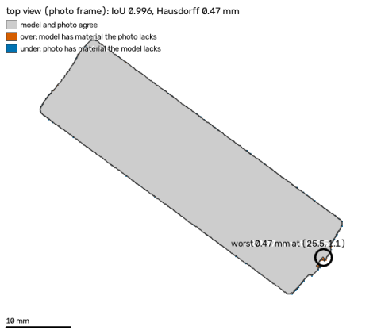
- **ref-aa-cell-tilt-s903698 · PS (reference_objects, held_out)** — worst length -1.20 mm 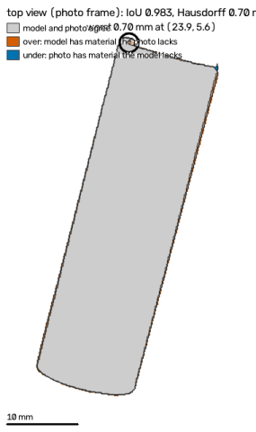
- **syn-battery-cover-low-light-s790551 · PS (synthetic, held_out)** — worst thickness -0.95 mm 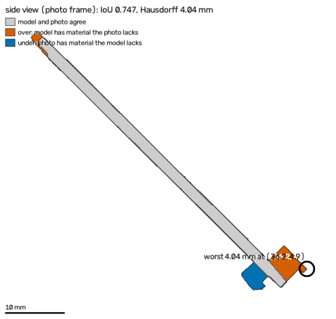
- **syn-cable-clip-white-part-s236478 · PS (synthetic, held_out)** — worst thickness -0.50 mm 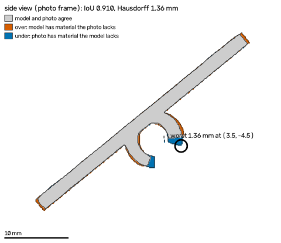
- **syn-clip-white-part-s468432 · PS (synthetic, held_out)** — worst thickness -0.80 mm 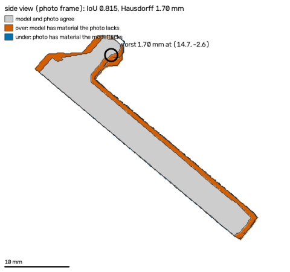
- **syn-hook-glare-s235877 · PS (synthetic, held_out)** — worst length -2.50 mm 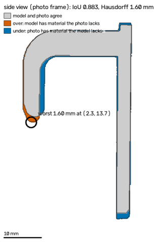
- **syn-hook-paper-s411102 · PS (synthetic, held_out)** — worst hole_1.diameter -0.55 mm 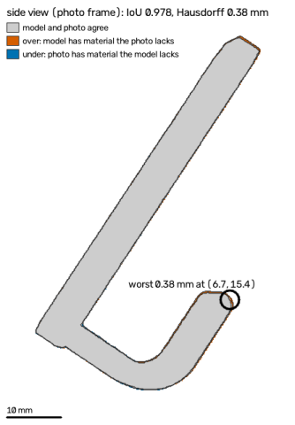
- **syn-hook-tilt-s656341 · PS (synthetic, held_out)** — worst length -4.30 mm 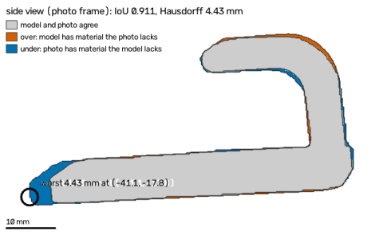
- **syn-knob-glare-s198000 · PS (synthetic, held_out)** — job failed: The part blends into the background — switch the screen mat to the dark stage (or use a darker surface). 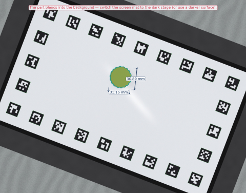
- **syn-l-bracket-moire-s114398 · PS (synthetic, held_out)** — job failed: Wavy stripes from the screen are visible — move the phone a little further away or rotate it slightly.
- **syn-l-bracket-moire-s928384 · PS (synthetic, held_out)** — worst thickness -9.70 mm 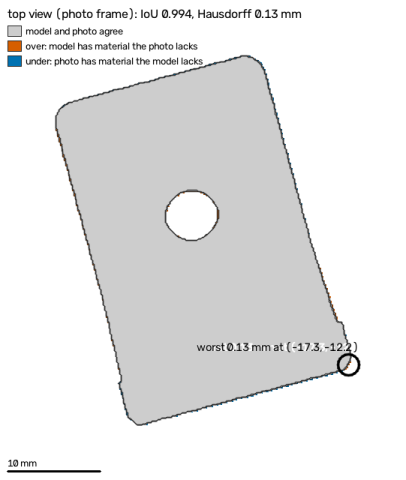

## Measurement only (Phase 1 bench)

From `eval/reports/2026-10-28/measure_only.json`: synthetic mean 0.468 mm, reference objects mean 0.178 mm → gate FAIL.
